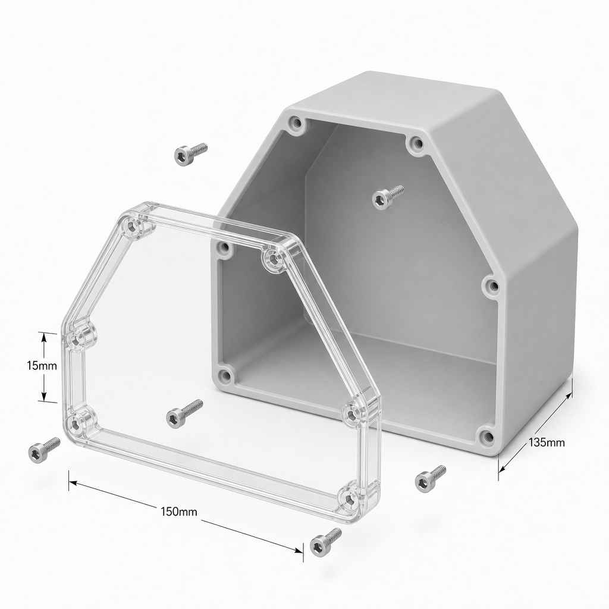
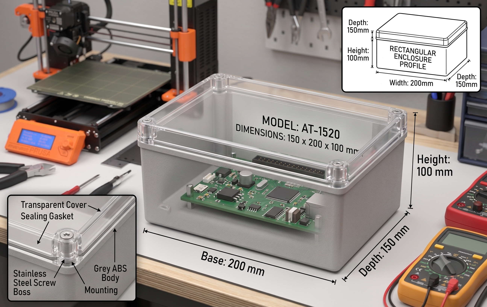

# LocalAiRobot

> A 1/10 RC crawler you can **talk to** — local LLM, speech-to-text, text-to-speech, **and a
> camera**, running **entirely on a Raspberry Pi 5 (16GB)**. No cloud, no Wi-Fi, fully offline.
> It drives on voice command, **stops for an obstacle directly ahead**, **looks around and drives
> toward things you name**, shows an **expressive face**, and talks back.

*Concept render — how the finished robot looks once the electronics are housed in the two enclosures (hexagonal front sensor module + rectangular rear electronics box). Full breakdown in [Enclosures](#enclosures--the-two-box-layout) below.*

> **Boards.** The reference build is a **Raspberry Pi 5**; the same brain also runs on an **NVIDIA Jetson
> Orin Nano** via a board HAL ([`brain/hal.py`](brain/hal.py)) that swaps only the GPIO/PWM/camera backends.
> Jetson setup uses [`scripts/install_stack_jetson.sh`](scripts/install_stack_jetson.sh) + the
> [board keys](config/README.md#board-pi-5--jetson) (`ROBOT_BOARD`, physical **BOARD** pins, I²C bus 7). The
> rest of this README is the **Pi 5** walkthrough.

## Quickstart — 5 steps to a talking robot

Car built and wired ([docs/assembly.md](docs/assembly.md))? SSH into the Pi and:

1. **Clone it** — `git clone https://github.com/YOUR_GITHUB_USER/LocalAiRobot.git ~/LocalAiRobot && cd ~/LocalAiRobot`
2. **Install it** — `./scripts/install_stack_pi5.sh` grabs the offline AI stack, sets your username, and enables the **IMX519 camera** overlay; then `sudo reboot` and SSH back in. *(On a Jetson Orin Nano, run `./scripts/install_stack_jetson.sh` instead.)*
3. **Patch it** — `./scripts/patches/common/1_esc_hb_qr_1060.sh` drops in your ESC's bench-tested defaults. Running any hardware other than the reference build (different camera, laser sensors, …)? there's a one-command patch for each, sorted into `common/` + your board's folder — **full catalog:** [scripts/patches/README.md](scripts/patches/README.md).
4. **Prove it** — ESC on, **wheels off the ground**: `./scripts/run_diagnostics.sh --wheels-off`. Green ✓ down the list; fix any red ✗ with the doc pointer it prints, then chase the **ALL-OK**.
5. **Drive it** — `./scripts/run_me.sh`, say *"hey jarvis"*, and go. (Bench first? `./scripts/run_me.sh --dry` — nothing moves.)

![LocalAiRobot voice + vision control flow: a voice command — started by a wake word (openWakeWord; ENTER push-to-talk survives in --dry only) — is transcribed by whisper.cpp, passes a trigger-phrase gate (EXPLORE/FIND only on explore words, otherwise DRIVE), and the gemma4:e4b-it-qat text model (Ollama) turns it into an intent JSON using recent context from a SQLite environment memory; DRIVE/STOP go to the driver.py control loop while EXPLORE/FIND run a behaviour loop that stops the car, captures a camera frame, asks the moondream VLM what is visible, records it to memory, and takes gated drive steps; a 3-sensor HC-SR04P array (front/left/right) gates FORWARD and informs steering; the PCA9685 drives the ESC (Electronic Speed Controller) / drive motor and steering servo; the text-intent and vision calls share one Ollama server behind a single model_lock (warmed at boot); replies are spoken via Piper TTS alongside short ack/greeting/thinking earcons, and a USB-C face screen reflects state (idle/listening/thinking/happy/confused/alarmed/warmup/capturing)](docs/images/basic_control_flow.png)

Everything runs on the Pi 5: **whisper.cpp** transcribes your voice, **Ollama** (`gemma4:e4b-it-qat`) turns
it into a JSON intent (a separate **`moondream`** VLM reads the camera), **Piper** speaks the reply, and
`driver.py` drives — a **PCA9685** makes jitter-free PWM for the **ESC** + steering servo (Ackermann: drive
+ steer, no spin), and 3× **HC-SR04P** cut forward motion near obstacles and keep steering off walls.
Control is the **wake word** (*"hey jarvis"*; **ENTER** in `--dry` bench mode).

**Autonomy is opt-in:** plain commands ("go forward", "stop") are teleop; the camera-driven
look-around / find-the-X only runs on an explore phrase, gated against the raw transcript so a mishear
can't send it wandering. **It is** voice teleop + a forward safety stop + bounded vision explore/find +
plain chat + a teachable people/things memory. **It isn't** self-driving, obstacle avoidance, or SLAM —
Pi-CPU vision is **slow** (tens of seconds a look), so "find the X" is a stop-look-step loop.

> 🛟 **Safety — software failsafe, no hardware watchdog.** The brain returns the ESC to neutral on
> STOP / error / obstacle / timeout, but a **killed process leaves the PCA9685 holding the last pulse** —
> keep a **physical kill switch on the motor battery** in reach and start slow. A missing board/sensor is
> logged by name and the brain runs degraded, not crashed.

---

## Parts list (with search terms)

Search terms are generic — use your preferred retailer.

> 🛒 **Ready-made cart:** the parts below are collected in this
> [**AliExpress wishlist**](https://www.aliexpress.com/p/wish-manage/share.html?spm=a2g0o.productlist.headerAcount.6.5b533bbc853DSK&smbPageCode=wishlist-amp&spreadId=EAF81BDA069358563ED6BEBC329A18554A43DABDD29B2526E03A87F05A681D99)
> if you'd rather buy the same items than search. Listings/prices change over time — confirm each against
> the search terms and notes here before ordering.

**Compute, power & audio (Pi side):**

| Part | Search term | Notes |
|---|---|---|
| Raspberry Pi 5, 16GB | `Raspberry Pi 5 16GB` | the brain |
| Active cooler | `Raspberry Pi 5 active cooler` | **mandatory** under sustained LLM/vision load; fit it first |
| Enclosure exhaust fan (optional) | `5V blower fan` + `logic-level N-channel MOSFET` (e.g. IRLZ44N / AO3400) | only if the electronics sit in a **sealed box** — a GPIO-switched fan vents hot air (`ROBOT_FAN_*`, [config](config/README.md#enclosure-cooling-fan--off-by-default)) |
| UPS HAT (pogo-pin) | `Raspberry Pi 5 UPS HAT 18650 pogo pin` | prefer the **pogo-pin, bottom-mount** type (e.g. Geekworm X1200/X1202) so it does **not** use the 40-pin header |
| 2× 18650 cells | `18650 flat-top high-drain 3000mAh` | genuine (Samsung/Sony); if not bundled with the UPS |
| Official PSU, 27 W | `Raspberry Pi 5 27W USB-C power supply` | **bench power while building (use this first, UPS later)** |
| microSD (or NVMe) | `high-endurance microSD 64GB` | OS storage (NVMe is much faster for model load) |
| USB microphone | `mini USB microphone` | voice input |
| USB speaker (**USB-powered**) | `mini USB powered speaker stereo` | TTS + earcon output. A **USB-powered** speaker (e.g. **Naciffo 2**) needs no separate PSU — ideal on a battery robot; plug-and-play, no 3.5 mm jack. **Any** USB speaker works — it's only a config value (`ROBOT_SOUNDS_DEVICE` + `~/.asoundrc`), no code change. |

**Vision & display:**

| Part | Search term | Notes |
|---|---|---|
| Camera | `Arducam IMX519 16MP autofocus Raspberry Pi` **or** fixed-focus `Raspberry Pi Camera V2 IMX219` / `OV5647` | visual input for the VLM. **IMX519 (autofocus) recommended** — it focuses on whatever you show it (a held-up object, a face), so `remember`/`find` shots are sharp. It's third-party, so `install_stack_pi5.sh` **enables its boot overlay for you** (official IMX219/OV5647 auto-detect — using one? install with `ROBOT_CAMERA_OVERLAY=none`). Any libcamera camera works — no code change. |
| **Pi 5 camera adapter cable** ⚠️ | `Raspberry Pi 5 camera cable 22-pin 0.5mm to 15-pin 1mm` | the Pi 5 CSI port is the narrow 22-way type; a bare V2's 15-way cable **won't fit** without this. **Some Arducam kits bundle it** (their "Pi Zero cable" is 22→15) — check before buying separately |
| IR illuminator (optional) | `850nm IR LED illuminator board` | a NoIR module sees nothing in the dark without IR light; skip for lit rooms / a standard module |
| Face screen — pick one | **USB-C:** `3.5 inch USB Type-C secondary screen 320x480 IPS` · **DSI:** `Freenove 5 inch DSI touchscreen 800x480 Raspberry Pi` | the robot's face. **USB-C** = the TURZX/"NO AIDA64" panel (USB-serial, `turing` backend). **DSI** = a ribbon panel like the Freenove 5" 800×480 (`framebuffer` backend, `/dev/fb0`). Either works — the code auto-detects; touch (if any) is unused. See [assembly](docs/assembly.md) |

**Vehicle & control electronics:**

| Part | Search term | Notes |
|---|---|---|
| Chassis | `1/10 SCX10 frame all-metal chassis 313mm` | roller, wheels included; you assemble it |
| Motor | `SURPASS 540 brushed motor 35T` | high-turn = torque; **not** a low-turn 13T |
| Pinion | `32P pinion gear 3.175mm 12T` | **32DP / M0.8**, 12–13T, 3.175 mm bore |
| ESC (Electronic Speed Controller) | `60A brushed crawler ESC program card 2-3S` | direct reverse + drag-brake stop (e.g. SURPASS HOBBY 60A). ⚠️ its **7.4 V BEC** powers the servo — see the servo note |
| Steering servo | `DSSERVO DS3225 digital servo 180` | 25 kg, **180°** (not 270°). ⚠️ use an **HV (7.4 V)** version, or feed V+ from a separate 5–6 V BEC — the 7.4 V ESC BEC can fry a 6 V servo |
| Battery | `3S 11.1V 5200mAh LiPo Deans` | powers **everything** — drive via the ESC, and the Pi via the buck converter below. Match the plug to the ESC; confirm your ESC (and servo BEC) are rated for 3S |
| **Adjustable buck converter** (Pi power) | `SZBK07 adjustable buck converter 20A` (a.k.a. `1PZ ABC-H10`) — or `XL4016 9A adjustable buck` | steps the 3S LiPo down to **7.4 V** to feed the **UPS HAT input** (the UPS re-regulates a clean ~5.1 V to the Pi). Must be a **switching** buck (not linear / **not** LM2596 — those sag), **≥ 8 A**, with a heatsink + a voltage display. **Set 7.4 V with a multimeter before connecting** (never > 8.4 V). ⚠️ A fixed 5–6 V "UBEC" does **not** work here — it sags ~0.5 V under load and browns the Pi 5 out (see [assembly Phase 2](docs/assembly.md#phase-2--power-one-3s-lipo-two-rails-read-before-you-wire)) |
| Charger | `IMAX B6 lipo balance charger` | balance-charges the 3S pack |
| Plug adapter | `T plug to Tamiya adapter` | only if the ESC (Electronic Speed Controller) plug ≠ battery plug |
| PWM driver | `PCA9685 16 channel servo driver I2C` | the PWM bridge to ESC (Electronic Speed Controller) + servo |
| **3× distance sensor** | `HC-SR04P ultrasonic sensor` | **buy three** (front/left/right). The **P** version is 3.3 V — no level shifter |
| Sensor mount | `HC-SR04 triple sensor bracket` | semi-hex front plate: one ahead, one ~45–60° left, one ~45–60° right (or 3D-print) |
| Jumper wires | `dupont jumper wire kit female female` | PCA9685↔Pi and 3× sensor↔Pi |

Tool: a **soldering iron** (PCA9685 headers, motor/ESC (Electronic Speed Controller) bullets).

> ⚠️ **Confirm with the chassis seller:** which of the two gearboxes you want (asked after you order),
> and the **spur gear pitch** — it must match the pinion (SCX10 standard is **32P / Mod 0.8**).

> 🔧 **Not the reference build?** Every hardware alternative has a **one-command patch** that writes the
> right `config/robot.env` keys — a different **ESC**, **camera** (OV5647 / official Camera Module 3),
> **obstacle sensors** (VL53L1X laser ToF), or an optional **IMU / wheel encoder**. Browse the full
> catalog with the exact hardware each one targets: [**scripts/patches/README.md**](scripts/patches/README.md).

---

## Enclosures — the two-box layout

The electronics ride in **two enclosures** (concept renders below). The split is deliberate:

- **Front — hexagonal sensor module.** The angled **half-hexagon** face is the whole point: it gives three
  flat facets to bolt the **HC-SR04P ultrasonic sensors** onto — one **dead ahead**, one **~45–60° left**,
  one **~45–60° right** — forming the semi-hex obstacle array, with the speaker/mic behind the clear lid.
- **Rear — rectangular module** (AT‑1520‑class, ~150 × 200 × 100 mm). Houses the Raspberry Pi 5, PCA9685,
  buck + UPS and wiring, with the **face/status screen** mounted on top.

Both are grey‑ABS boxes with a clear, gasketed lid on stainless screw bosses — pop the lid to work inside
without unmounting anything.

> 📦 **Printable models (body + lid).** The enclosure is provided as 3MF in
> [`docs/enclosure_models/`](docs/enclosure_models/): [`junction_box_body.3mf`](docs/enclosure_models/junction_box_body.3mf)
> and [`junction_box_lid.3mf`](docs/enclosure_models/junction_box_lid.3mf). Upload the two files straight to a
> print service such as [**JLC3DP**](https://jlc3dp.com/) (or slice and print them at home).

---

## Wiring at a glance

Full build + calibration in [docs/assembly.md](docs/assembly.md); pin-by-pin wiring in
[docs/wiring/pwm-esc-servo-wiring.md](docs/wiring/pwm-esc-servo-wiring.md) (drive & steering) and
[docs/wiring/ultrasonic-sensors-wiring.md](docs/wiring/ultrasonic-sensors-wiring.md) (3× HC-SR04P sensors).

![LocalAiRobot wiring at a glance: a single 3S 11.1V LiPo feeds the ESC (Electronic Speed Controller) (drive motor + a BEC for the servo) AND an adjustable buck converter (set to 7.4V); the ESC (Electronic Speed Controller)'s 3-wire plug goes to PCA9685 ch0 (signal + V+ from the ESC BEC + GND) and the steering servo to ch1 (signal/V+/GND); the PCA9685 takes VCC 3.3V + SDA(GPIO2) + SCL(GPIO3) + GND from the Raspberry Pi 5; three HC-SR04P sensors (front GPIO23/24, left GPIO5/6, right GPIO20/21) take 3.3V + GND + TRIG/ECHO from the Pi; the Arducam IMX519 autofocus camera connects over the CSI ribbon and the USB-C face screen over USB; the Pi 5 is powered by the buck converter (7.4V) into the UPS HAT (2x 18650 backup), which re-regulates a clean 5.1V to the Pi. One LiPo, two rails, common ground.](docs/images/wiring.png)

- **One 3S LiPo powers everything** — an **ESC** branch (drive motor + a BEC for the servo) and an **adjustable buck (7.4 V) → UPS HAT → Pi** branch (the 18650s buffer spikes; the UPS re-regulates a clean ~5.1 V). **Tie all grounds together** (Pi ⟷ PCA9685 ⟷ ESC (Electronic Speed Controller) ⟷ buck) or the PWM won't register. ⚠️ A fixed 5–6 V UBEC sags too far under load — use an adjustable buck at 7.4 V into the UPS ([why](docs/assembly.md#phase-2--power-one-3s-lipo-two-rails-read-before-you-wire)).
- PCA9685 **V+ rail = the ESC (Electronic Speed Controller)'s BEC** (the servo rail), *not* the Pi (so use an HV servo, or feed V+ from a separate 5–6 V BEC). All three HC-SR04**P** run at **3.3 V**, so every ECHO is Pi-safe (no divider).
- **Pins:** I2C on GPIO2/3 (PCA9685 @ `0x40`); forward sensor TRIG/ECHO `23/24`, left `5/6`, right `20/21`. Camera is on the CSI ribbon, the face panel on USB — neither touches the GPIO header.

---

## Running it

The **Quickstart** above is the whole happy path; the full phased build + calibration lives in
[docs/assembly.md](docs/assembly.md). A few things worth knowing:

- **Bench-test first (no chassis, no motor):** `./scripts/run_me.sh --dry` fakes all hardware and logs
  exactly what it *would* drive (voice → model → PWM), so you can verify the pipeline before anything can
  move. On the *built* car, `ROBOT_MOTORS_OFF=1` runs everything live but sends the ESC/steering no signal
  — talk to it on a desk without it driving off.
- **Day-to-day launcher:** `./scripts/run_me.sh` runs foreground (`--dry` / `--live`, Ctrl-C to stop);
  `--detach` backgrounds it, `--install-boot` (or `install_stack_pi5.sh --bootstrap`) auto-starts it on every
  boot, `--reload` re-applies an edited `config/robot.env`.
- ☁️ **Optional — remote brain (Gemini).** The LLM + vision run **locally/offline by default**. To use
  Google Gemini instead (faster, but online + an API key, and camera frames leave the device): get a key
  ([docs/gemini-setup.md](docs/gemini-setup.md)), set `ROBOT_GEMINI_API_KEY=` + `ROBOT_AI_BACKEND=gemini`,
  and restart. Flip back with `ROBOT_AI_BACKEND=local` — only the LLM/vision switch; speech, sensors,
  motors and the wake word stay local.
- 📶 **Switch Wi-Fi in the field — no monitor/keyboard.** Move the robot onto a new network, or recover
  SSH access, from just your phone (a phone-hotspot fallback + a Comitup captive portal, plus passwordless
  Ed25519 SSH): [docs/change-pi-wifi.md](docs/change-pi-wifi.md).
- 📱 **Command it from your phone over Wi-Fi.** A tiny token-secured HTTP endpoint (on by default, runs
  *inside* the brain) turns your phone's keyboard mic into a remote — speak, and it runs the **same** brain
  as the wake word: it drives/answers, **speaks the reply, and returns it as JSON**. First launch prints a
  ready URL + auto-generated token. Setup + security: [docs/http_setup.md](docs/http_setup.md).

---

## Voice command model

The LLM returns one JSON object; the Pi validates and clamps it before acting:

| Key | Values | Notes |
|---|---|---|
| `action` | `DRIVE` / `EXPLORE` / `FIND` / `STOP` / `SAY` / `REMEMBER` | default `DRIVE`. **`EXPLORE`/`FIND` only run if an explore phrase is in the transcript** (else → `DRIVE`). `SAY` = answer in words, no motion. `REMEMBER` = photograph + store a named person/thing |
| `target` | object name (`FIND`) or a person/thing **name** (`REMEMBER`, e.g. `"Shani"`) | required by `FIND` and `REMEMBER` |
| `note` | relationship / description for `REMEMBER` (e.g. `"my wife"`) | optional |
| `drive` | `FORWARD` / `REVERSE` / `STOP` | used by `DRIVE`; unknown → `STOP` (fail-safe) |
| `steer` | `LEFT` / `CENTER` / `RIGHT` | unknown → `CENTER`; to turn, the car must be moving |
| `speed` | `0`–`100` | mapped into the ESC's usable range (`ROBOT_MIN_FORWARD_SPEED`/`ROBOT_MAX_FORWARD_SPEED`; reverse `ROBOT_MIN_REVERSE_SPEED`/`ROBOT_MAX_REVERSE_SPEED`) |
| `duration_ms` | `300`–`5000` | run time before the failsafe neutralizes the move |
| `reply` | short text | spoken via Piper (stdin, no shell → no injection) |

**Explore & find.** On *"look around"* the car runs an **agentic** loop: each step the model sees the frame
+ memory + sensor distances and picks the next move (and decides when it's satisfied) — bounded by
backend-aware time/step caps (**2× on the faster remote model**), gated by the forward sensor, held at
neutral each look, and **interruptible** any time (phone `POST /stop`, the wake word, or Ctrl-C). *"find the
X"* runs a bounded stop → look → step loop toward a sighting. Each look's **full scene description is stored**
to memory, so a later (offline) run reuses what a remote run learned.

**Memory.** Sightings and taught people/things go to SQLite. Say *"this is my wife Shani"* (`REMEMBER`) and
it photographs, has the VLM describe it, and stores name + relationship + description + the JPEG; each turn
it injects known entities into the prompt — a lightweight RAG — so context survives commands and reboots.
`SAY` handles plain chat: it answers in words and stays put.

**Face.** A small display shows the robot's state (`idle / listening / thinking / …`) — the built-in
procedural face, or your PNG frames in `brain/faces/<state>/`. It auto-selects a backend (USB-C → DSI/HDMI
→ simulated) and is optional; a missing panel never blocks driving. Design your own on your PC
(`./scripts/host_setup.sh` installs the tools): [`brain/faces/README.md`](brain/faces/README.md), [`sounds/README.md`](sounds/README.md).

**Wake word & warmup.** Control is the wake word (*"hey jarvis"*, shipped in [`models/`](models/README.md);
or train your own: [`tools/wakeword-training/`](tools/wakeword-training/README.md)) — always-listening, the only *live* trigger
(ENTER stays in `--dry`), and what lets the brain run headless. Short earcons ([`sounds/`](sounds/README.md))
+ a boot warmup (`ROBOT_WARMUP`, keep-alive) mask the slow first load, and a `model_lock` serialises the
text-intent and vision calls.

**Tuning.** Every setting lives in [`config/robot.env`](config/robot.env), each documented (default + what
it does) in [`config/README.md`](config/README.md). After the one-time downloads, disable Wi-Fi — it all
runs on-device.

---

## Concierge Mode (optional) — a stationary greeter

Flip `ROBOT_CONCIERGE_MODE=1` and Jarvis becomes a **stationary desk concierge** instead of a crawler: it
**never drives** (every move request gets a polite in-character refusal), introduces itself as *"Jarvis the
Concierge"*, and — on top of the wake word — wakes on a **PIR motion sensor**. When someone walks up it shows
a friendly face and runs a **strictly-local** pipeline (OpenCV face-detect → ArcFace ONNX embed → match
against the RAG database) to **greet people it knows by name**, or smile silently at strangers; then it hands
off to a normal chat. Set it back to `0` for the crawler car — nothing else changes. Full setup, wiring +
the state-machine flow: **[docs/concierge.md](docs/concierge.md)**.

**Quick start (Pi 5 — greet people from photos you already have):**

> Needs a **PIR motion sensor** + a **camera** (the CSI camera the installer sets up works; USB webcam? add
> `./scripts/patches/pi5/3_camera_usb_webcam.sh`). Concierge **never drives**, so **skip** the ESC patch and
> the wheels-off diagnostics from the main Quickstart.

1. **Wire the PIR** — `OUT → GPIO4 (physical pin 7)`, `VCC → 5V (pin 2)`, `GND → GND (pin 6)`. The Adafruit PIR's OUT is 3.3 V → Pi-safe, no divider. `ROBOT_PIR_PIN=4` is already the default. Wiring guide: [docs/wiring/pir-sensor-wiring.md](docs/wiring/pir-sensor-wiring.md).
2. **Clone** — `git clone https://github.com/YOUR_GITHUB_USER/LocalAiRobot.git ~/LocalAiRobot && cd ~/LocalAiRobot`
3. **Install** — `./scripts/install_stack_pi5.sh` (grabs the AI stack **and** the local face-recognition model), then `sudo reboot` and SSH back in.
4. **Test the PIR** — `./scripts/pir_sensor_probe.sh`, wave your hand, watch it flip to `#### MOTION ####` (Ctrl-C to stop). *Runs only after step 3 — it uses the installed venv.*
5. **Enable Concierge Mode** — `sed -i 's/^ROBOT_CONCIERGE_MODE=.*/ROBOT_CONCIERGE_MODE=1/' config/robot.env`
6. **Copy your photos to the Pi** *(run on your laptop)* — `scp ~/people/ramesh*.jpg pi@raspberrypi.local:~/`
7. **Enrol each person from those photos** — `./scripts/enroll_person.sh "Ramesh" "my creator" ~/ramesh1.jpg ~/ramesh2.jpg` — repeat per person; give a few photos each (different angles/lighting) for better matching.
8. **Run it** — foreground now: `./scripts/run_me.sh`. Always-on (headless desk greeter): `./scripts/run_me.sh --install-boot` **then** `sudo systemctl start robot.service`.

Walk up and it greets enrolled faces by name; strangers get a silent smile. Remove someone: `./scripts/rag.sh --forget "Name"`.

**Two enrol scripts — which one?**

| Script | Enrols from | Stores | Use when |
|---|---|---|---|
| **`enroll_person.sh "Name" "desc" a.jpg b.jpg`** | **photo files** you already have | face embedding **+ a description** | the scp workflow above; **safe while the robot is live** (reads files, not the camera) |
| `enroll_face.sh "Name"` | the Pi's **live camera** (stand in front of it) | face embedding only | enrolling someone physically present — **stop the brain first** (`./scripts/shutdown.sh`), it holds the camera |

**Multiple photos per person → better recognition.** Enrol the *same* person several times (different angles /
lighting) — each photo is stored as its own embedding under their name, and both enrol scripts accumulate
(`enroll_person.sh` takes many files at once; `enroll_face.sh` takes N webcam shots). On a match, all of a
person's photos are combined per **`ROBOT_FACE_ID_AGGREGATE`**: `max` (default — the best-matching photo wins,
so more photos = better recall), or `topk` / `mean` / `centroid` if a single stray shot ever causes a false
greeting. Check who's enrolled and with how many photos: **`./scripts/rag.sh --faces`**.

## 📚 Documentation

Everything in this repo, with a one-line "what's this for" — so nothing's a dead end.

**Build & wire**
- [docs/assembly.md](docs/assembly.md) — the full phased build: flash → brain → power → PCA9685 → sensors → camera → face → calibration.
- [docs/wiring/pwm-esc-servo-wiring.md](docs/wiring/pwm-esc-servo-wiring.md) — pin-by-pin drive + steering wiring (PCA9685 → ESC/servo).
- [docs/wiring/ultrasonic-sensors-wiring.md](docs/wiring/ultrasonic-sensors-wiring.md) — pin-by-pin wiring for the 3× HC-SR04P sensors.
- [docs/wiring/pir-sensor-wiring.md](docs/wiring/pir-sensor-wiring.md) — pin-by-pin wiring for the optional Concierge-Mode PIR motion sensor.

**Set up & run**
- [scripts/patches/README.md](scripts/patches/README.md) — one-command hardware patches (ESC / sensors / camera / IMU / encoder), sorted into `common/` + your board's folder.
- [docs/diagnostics.md](docs/diagnostics.md) — the `run_diagnostics.sh` live self-test (green/red per peripheral + the pin map) explained.
- [docs/gemini-setup.md](docs/gemini-setup.md) — optional: run the brain on remote Google Gemini instead of local Ollama.
- [docs/concierge.md](docs/concierge.md) — optional **Concierge Mode**: a stationary greeter with PIR motion wake + strictly-local face recognition (`ROBOT_CONCIERGE_MODE`).
- [docs/http_setup.md](docs/http_setup.md) — command the robot from your phone over Wi-Fi (the token-secured HTTP endpoint).
- [docs/change-pi-wifi.md](docs/change-pi-wifi.md) — **field networking & recovery**: phone-hotspot backup, Comitup portal, persistent boot logs, and connecting from your phone with **ConnectBot** (+ Ed25519 SSH keys).

**Configure & customise**
- [config/README.md](config/README.md) — every `config/robot.env` key: default + what it does (incl. the Pi-5 vs Jetson board keys).
- [docs/opnewakeword/openwake-word.md](docs/opnewakeword/openwake-word.md) — how the "hey jarvis" wake word works + tuning it.
- [tools/wakeword-training/README.md](tools/wakeword-training/README.md) — train your own wake word (e.g. "hey richard").
- [brain/faces/README.md](brain/faces/README.md) — design the robot's face (procedural or your own PNG animations).
- [sounds/README.md](sounds/README.md) — the spoken earcons (ack / greeting / thinking / error cues).
- [models/README.md](models/README.md) — the committed wake-word models.

---

## Credits & license

MIT — see [LICENSE](LICENSE). Built on [Ollama](https://ollama.com/) +
[Gemma](https://ai.google.dev/gemma) + [moondream](https://moondream.ai/), [whisper.cpp](https://github.com/ggerganov/whisper.cpp),
[Piper](https://github.com/rhasspy/piper), [picamera2](https://github.com/raspberrypi/picamera2),
[gpiozero](https://gpiozero.readthedocs.io/),
[Adafruit ServoKit / PCA9685](https://github.com/adafruit/Adafruit_CircuitPython_ServoKit),
[openWakeWord](https://github.com/dscripka/openWakeWord), and
[turing-smart-screen-python](https://github.com/mathoudebine/turing-smart-screen-python).
