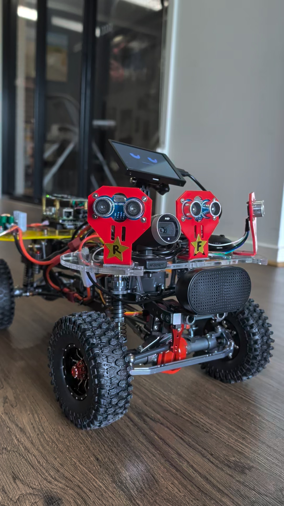
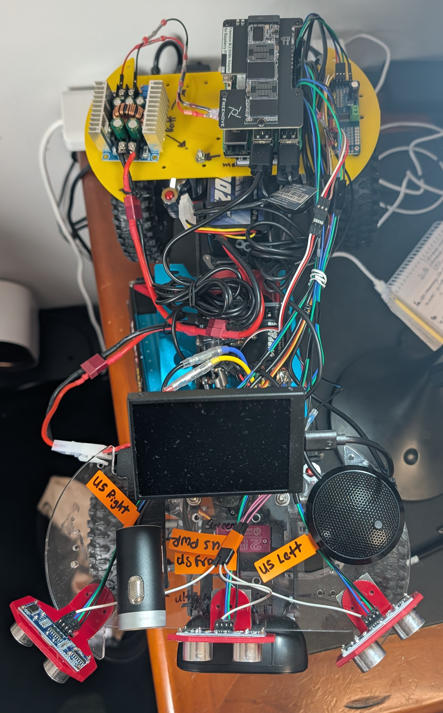

# LocalAiRobot

A robot you can talk to, running entirely on a Raspberry Pi 5. Say "hey jarvis" and it listens, works out
what you mean with a local language model, answers out loud, looks through its camera and pulls faces on its
screen. Build it as a 1/10 RC crawler that drives where you tell it, or as a wall-mounted greeter that knows
your family by name. It works offline: only the optional Gemini brain and the weather forecast use the internet.

<p align="center">
  
  
</p>

*The crawler: Pi 5, power and motor board on the rear deck; face, camera, microphone, speaker and three
distance sensors up front.*

## What it does

- **Talks and listens offline.** openWakeWord hears "hey jarvis", whisper.cpp writes down what you said,
  Gemma (on Ollama) decides what to do, and Piper speaks the answer. Google Gemini can stand in as a faster brain.
- **Drives on voice command** ("go forward", "turn left", "stop") and stops for anything right in front of it.
- **Looks around and finds things you name**, using a local vision model and three ultrasonic sensors.
- **Knows people.** In Concierge mode it recognises faces on the Pi, greets people by name, remembers what
  they told it and shows a 3-day forecast.
- **Runs on a Pi 5 or an NVIDIA Jetson Orin Nano** from the same code, with tests that need no hardware.

## What you need

- Raspberry Pi 5 (16 GB) with the active cooler, a microSD card and the official 27 W power supply
- USB microphone, USB speaker and a USB webcam
- For the crawler: a 1/10 crawler chassis, motor, ESC, steering servo, PCA9685 PWM board, three HC-SR04P
  ultrasonic sensors and a 3S LiPo
- For the greeter: a PIR motion sensor

You can start with just the Pi, the microphone and the speaker, and add the rest later. Full list with
search terms: [docs/parts.md](docs/parts.md). Build steps: [docs/assembly.md](docs/assembly.md).

## Quick start

These steps assume a Pi 5 running Raspberry Pi OS Lite (64-bit) that you can reach over SSH. Starting from
a blank SD card? Follow [docs/install.md](docs/install.md) instead.

1. Plug in the USB microphone and speaker, then install. It takes a while; say yes when it offers to reboot:
   ```bash
   git clone https://github.com/shen747/LocalAiRobot.git ~/LocalAiRobot
   cd ~/LocalAiRobot && ./scripts/install_stack_pi5.sh     # Jetson: ./scripts/install_stack_jetson.sh
   ```
2. Try it on the bench, where nothing can move. Press Enter, say "go forward and bear left", and read what it
   would do:
   ```bash
   cd ~/LocalAiRobot && ./scripts/run_me.sh --dry
   ```
3. Tell it about your hardware:
   ```bash
   ./scripts/patches/common/1_esc_hb_qr_1060.sh   # your ESC
   ./scripts/patches/pi5/3_camera_usb_webcam.sh   # your camera
   ```
   Different parts? Pick yours from the [patch list](scripts/patches/README.md).
4. Check the wiring with the ESC on and the wheels off the ground:
   ```bash
   ./scripts/run_diagnostics.sh --wheels-off
   ```
5. Run it and say "hey jarvis". To start it on every boot, add `./scripts/run_me.sh --install-boot`.
   ```bash
   ./scripts/run_me.sh --live
   ```

**Safety: keep a physical kill switch on the motor battery.** The software stops the motor on errors and
obstacles, but if the program itself is killed, the motor board keeps its last command.

## Pick a mode

| Mode | What it does | Guide |
|---|---|---|
| Crawler (default) | Drives, explores and finds things on voice command | [docs/crawler.md](docs/crawler.md) |
| Concierge | Stays put, wakes on motion, greets people by name | [docs/concierge.md](docs/concierge.md) |
| Halloween | A Concierge extra that scares trick-or-treaters, kindly | [docs/halloween.md](docs/halloween.md) |

<p align="center">
  
</p>

*The Concierge build on a wall, showing its forecast card.*

## Make it yours

- **Settings:** edit `config/robot.env` (your own copy, which git ignores), then `./scripts/run_me.sh --reload`.
  The common ones are in [docs/configuration.md](docs/configuration.md), and every one is in
  [config/README.md](config/README.md).
- **Voice and pronunciation:** [sounds/README.md](sounds/README.md).
- **Face:** draw your own frames as PNGs, see [brain/faces/README.md](brain/faces/README.md).
- **Wake word:** use "hey jarvis" or train your own, see [docs/openwakeword/openwake-word.md](docs/openwakeword/openwake-word.md).
- **Code:** [docs/development.md](docs/development.md) shows where everything lives and how to run the tests.

Every other guide (wiring, updating, troubleshooting, Wi-Fi recovery, the phone remote, weather) is listed in
[docs/README.md](docs/README.md).

## Credits and licence

MIT, see [LICENSE](LICENSE), except the third-party models and data below, which keep their own licences.

Built on [Ollama](https://ollama.com/), [Gemma](https://ai.google.dev/gemma), [moondream](https://moondream.ai/),
[whisper.cpp](https://github.com/ggerganov/whisper.cpp), [Piper](https://github.com/rhasspy/piper),
[openWakeWord](https://github.com/dscripka/openWakeWord), [OpenCV](https://opencv.org/) (YuNet face detector),
[InsightFace](https://github.com/deepinsight/insightface) (ArcFace embeddings),
[picamera2](https://github.com/raspberrypi/picamera2), [gpiozero](https://gpiozero.readthedocs.io/),
[Adafruit ServoKit](https://github.com/adafruit/Adafruit_CircuitPython_ServoKit),
[turing-smart-screen-python](https://github.com/mathoudebine/turing-smart-screen-python) and, optionally, the
[Google Gemini API](https://ai.google.dev/gemini-api).

**Third-party models and data**
- [`models/hey_jarvis.onnx`](models/README.md) is openWakeWord's pre-trained model, licensed
  [CC BY-NC-SA 4.0](https://creativecommons.org/licenses/by-nc-sa/4.0/) (non-commercial), not MIT.
- The face-recognition models are downloaded at install time from InsightFace, whose pre-trained models are
  for non-commercial research use only.
- [`models/person_nanodet.onnx`](models/README.md) (Halloween Mode's person detector) is OpenCV Zoo's
  NanoDet-Plus, licensed [Apache 2.0](https://www.apache.org/licenses/LICENSE-2.0).
- Weather data by [Open-Meteo.com](https://open-meteo.com/), licensed
  [CC BY 4.0](https://creativecommons.org/licenses/by/4.0/).
