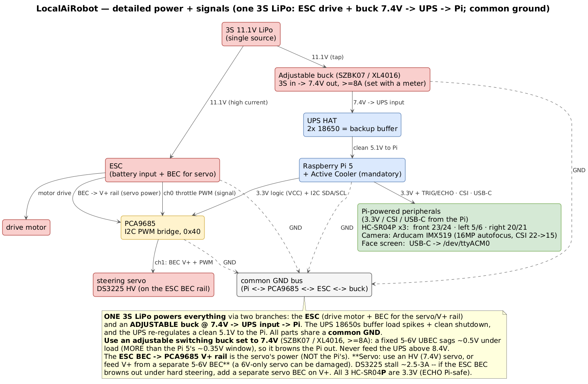

# Assembly

Build the crawler one tested step at a time. Steps 1 to 6 happen on the bench, on the 27 W power supply, with
no motor connected, so nothing can move until step 7. The concierge only needs steps 1, 5 and 6, plus its
[PIR](wiring/pir-sensor-wiring.md). What to buy: [parts.md](parts.md).


*The diagram shows a ribbon camera; the build now uses a USB camera.*

A few terms: **GPIO** pins are the Pi's numbered pins. **I²C** is the two-wire bus to the **PCA9685**, the board
that makes the timed **PWM** pulses for speed and steering. The **ESC** turns those pulses into motor power, and
its built-in **BEC** supply also powers the steering servo. The **HC-SR04P** is the 3.3 V ultrasonic distance
sensor, and the **LiPo** is the motor battery.

**Safety: fit a physical kill switch on the battery-to-ESC wire before the ESC is ever connected.** More in
[Safety](#safety).

## 1. Install the software

Follow [install.md](install.md), steps 1 to 8: fit the cooler, flash the card, install, and talk to the robot
in dry run. Everything below assumes that works.

## 2. Power



One 3S LiPo feeds two branches: the ESC, which drives the motor and whose BEC powers the servo, and an
adjustable buck converter at 7.4 V that feeds the UPS HAT, which gives the Pi a clean 5.1 V.

- **Never wire the LiPo straight to the Pi.** It goes through the buck converter and the UPS.
- **Join all the grounds** (Pi, PCA9685, ESC, buck converter), or the PWM signals won't register.
- Put the kill switch on the LiPo to ESC wire, and take the buck converter's feed after the switch, so the switch
  cuts the drive while the UPS keeps the Pi running for a clean stop.
- **Set the buck converter to 7.4 V with a multimeter before connecting it, and never above 8.4 V.** Use a
  switching type rated 8 A or more, with short, thick wires (18 AWG or heavier).
- **Don't use a fixed 5 to 6 V UBEC.** The Pi 5 only accepts about 4.9 to 5.25 V, and a cheap UBEC sags around
  0.5 V under load, so the Pi browns out: SSH freezes and speech cuts off mid-word. At 7.4 V into the UPS a sag
  doesn't matter. Watch the real input voltage with `vcgencmd pmic_read_adc | grep EXT5V_V`.
- A battery can't negotiate USB power the way the 27 W supply does, so the Pi would limit all its USB ports to
  600 mA, too little for the speaker, microphone and face screen. The installer lifts that limit
  (`usb_max_current_enable=1`, after a reboot).
- **The ESC's BEC gives 7.4 V. Use an HV (7.4 V) servo,** or power the servo rail from a separate 5 to 6 V BEC.
- Charge the LiPo only with a balance charger, and match its plug to the ESC.

## 3. PWM board

The Pi can't make clean servo pulses while it runs the language model, so the PCA9685 makes them. With the ESC
still disconnected, wire just its logic side: VCC to 3.3 V, SDA to GPIO 2, SCL to GPIO 3 and GND to ground. Check
it with `i2cdetect -y 1`, which should show `40`. Pin by pin: [PWM wiring](wiring/pwm-esc-servo-wiring.md).

The DS3225 servo can draw 2.5 to 3 A when it stalls. If steering browns out under load, give the servo rail its
own BEC.

## 4. Distance sensors

Three HC-SR04P sensors across the front: one straight ahead, one 45 to 60° left and one 45 to 60° right. On
3.3 V their echo signal is safe for the Pi, with no level shifter. Pins (BCM): front 23/24, left 5/6,
right 20/21. Pin by pin: [ultrasonic wiring](wiring/ultrasonic-sensors-wiring.md).

Check them with `./scripts/test_sensors.sh`: cover each sensor in turn and only its number should drop. You're
done when all three track real distances, rather than staying blank or stuck at 400 cm.

## 5. Camera

Plug in the USB camera and run one patch, then `./scripts/run_me.sh --reload`:

```bash
./scripts/patches/pi5/3_camera_usb_webcam.sh 0      # any USB webcam
./scripts/patches/pi5/3_camera_usb_ir_1080p.sh 0    # or a 1080p IR night-vision module
```

The start-up log should show `camera: OpenCV/v4l2 ...` with the resolution you asked for.

- **Resolution matters for face recognition.** Check what the camera really offers with
  `v4l2-ctl --list-formats-ext -d /dev/video0` (you want MJPG 1920x1080 at 30 fps), and measure face sizes where
  people will stand with `./scripts/camera_face_probe.sh`.
- An IR module's night pictures are greyscale, so enrol a few night photos of each person too.
- A fixed-lens module needs `ROBOT_CAMERA_AUTOFOCUS=0` (the IR patch sets it).
- Vision on the Pi's CPU is slow, tens of seconds per look, and the car stays still while it looks.

## 6. Face screen

`ROBOT_FACE_BACKEND=auto` finds either screen; with neither, the robot runs without a face.

- **USB-C panel:** connect it with a data cable; it appears as `/dev/ttyACM0`. The installer adds you to the
  `dialout` group, so log out and back in. Run `simple-program.py` in `~/turing-smart-screen-python` once to see
  which revision drives it, then set `ROBOT_FACE_REVISION=A` or `B`.
- **DSI screen:** plug the ribbon into a CAM/DISP port and check that `/dev/fb0` exists. It only shows on a
  console boot.

Custom faces: [brain/faces/README.md](../brain/faces/README.md).

Now run the robot live on the bench, still with no motor:

```bash
i2cdetect -y 1                  # PWM board at 40
lsusb | grep -i 1a86            # the USB-C panel (or: ls /dev/fb0 for a DSI screen)
./scripts/test_sensors.sh       # the three sensors
./scripts/run_me.sh --live
```

## 7. Build the chassis

This is where the ESC, motor and battery finally connect.

1. Assemble the chassis. Fit the 540 35T motor and mesh the pinion with the spur gear, with a strip of paper
   between them while you tighten to leave a little play.
2. Fit the steering servo and its link. Leave the servo horn off until calibration has found the centre.
3. Mount the Pi and its cooler on a deck over the frame rails, with the fan's airflow clear.
4. Mount the ESC, PCA9685, buck converter and LiPo, with wires clear of the driveshafts and steering. Keep the
   microphone away from the fan. Then make the power connections: ESC to motor, the ESC's three-wire lead to the
   PCA9685 (the channel your ESC patch sets), steering servo to channel 1, LiPo to ESC through the kill switch,
   and LiPo to the buck converter (7.4 V) to the UPS HAT to the Pi. Pin by pin:
   [PWM wiring](wiring/pwm-esc-servo-wiring.md).
5. Mount the sensor plate across the front, roughly level, and the camera and face screen facing forward.

**Optional exhaust fan**, only if the electronics sit in a sealed box: mount a 5 V fan on the box wall blowing
out, with a vent low on the opposite side. A GPIO pin can't power a fan, so switch it with a logic-level N-channel
MOSFET: GPIO to the gate (with a 10 kΩ resistor from gate to ground so it stays off at boot), fan + to 5 V,
fan - to the drain, source to ground, and a diode across the fan. Then set `ROBOT_FAN_ENABLE=1` and
`ROBOT_FAN_PIN`; the robot runs the fan when the chip gets hot.

## 8. First drive

**Keep the wheels off the ground until the last step, with the kill switch in reach.**

1. Run `./scripts/run_diagnostics.sh` and fix anything red ([diagnostics.md](diagnostics.md)).
2. Find your throttle and steering values with [calibration.md](calibration.md).
3. Start the robot with the LiPo connected. It holds neutral for `ROBOT_ESC_ARM_SECS` while the ESC beeps its
   cell count and then one long "ready" beep. No long beep? Power-cycle the ESC while the robot holds neutral.
   Still nothing: check the signal and ground wires to the PCA9685, and the BEC.
4. Say "center", "left" and "right", and adjust `ROBOT_STEER_*` until the wheels centre and turn fully without
   the servo buzzing.
5. Say "go forward" slowly, then "go back". Wheels turning the wrong way? Swap the two motor wires, or set
   `ROBOT_THROTTLE_INVERT=1`.
6. Say "go forward" with a hand about 20 cm in front of the front sensor: the motor should cut out and the robot
   say "Obstacle ahead. Stopping."
7. Say "look around": it should describe what it sees.
8. Only now put it on the floor, at low speed.

`ROBOT_MOTORS_OFF=1` runs everything live except the wheels, for testing the rest on a desk.

## 9. UPS HAT

Add it once everything works on the 27 W supply. Use a pogo-pin, bottom-mount HAT (Geekworm X1200 or X1202,
Waveshare UPS HAT B or E), which powers the Pi from underneath and leaves the 40-pin header free. Stack it
cooler, Pi, then UPS. Its fuel gauge sits at I²C address `36`, so `i2cdetect -y 1` shows `36` and `40`. Follow the
HAT's own charging and power-up order.

## On a Jetson Orin Nano

The build is the same. Install with `./scripts/install_stack_jetson.sh` (JetPack 6 comes installed, so there's no
card to flash). GPIO uses physical header pin numbers: the installer comments out the Pi pins, so check the
Jetson defaults against your wiring with `sudo /opt/nvidia/jetson-io/jetson-io.py`. The PCA9685 is on I²C bus 7
(`ROBOT_I2C_BUS=7`), and the camera patches are in `scripts/patches/jetson/`. See the
[board settings](../config/README.md#board).

## Safety

The software returns the ESC to neutral on "stop", on any error, when something is in front of the front sensor
and when a move's time runs out, and it arms the ESC at neutral. That's software only: if the program is killed,
the PCA9685 keeps sending its last pulse and nothing stops the motor. **The kill switch on the LiPo is your real
safety net.** Keep speeds low and moves short.
