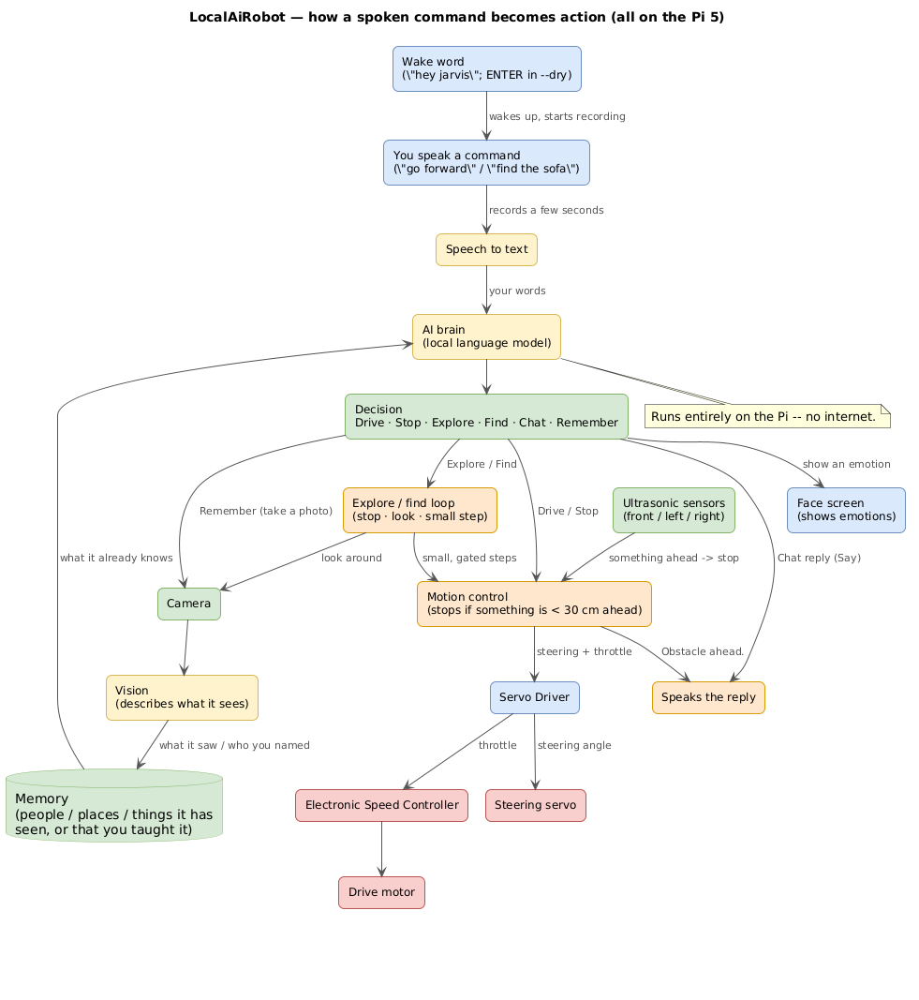

# Development

Where the code lives, how to test it and how to add things. The robot is plain Python in `brain/`, started by
`scripts/run_me.sh` or the boot service, and it reads its settings from environment variables loaded from
`config/robot.env`.



## How one turn works

1. `wait_for_trigger()` in `brain/main.py` waits for the wake word (`wakeword.py`), a motion wake (`pir.py`,
   `wake_sources.py`) or a phone command (`remote.py`).
2. `listen_and_transcribe()` records you and runs whisper.cpp.
3. `handle_command()` asks the model, through `inference.py` (Ollama or Gemini), for one JSON command, checks it,
   then acts: `driver.py` drives, `behavior.py` explores, `vision.py` looks, `memory.py` remembers.
4. `say()` speaks the reply with Piper while `face.py` shows the matching face and `sounds.py` plays the clips.
5. The conversation carries on without the wake word until you go quiet.

A concierge motion wake takes a different branch (look for `trigger == "MOTION"` in `main.py`): a quick look,
then face recognition, then a greeting. [concierge.md](concierge.md) describes it.

## Where things live

| File | What it does |
|---|---|
| `brain/main.py` | start-up, the main loop, `handle_command()`, the crawler's prompt (`_CRAWLER_INTRO`, `_ACTION_SCHEMA`) and the phrase checks for explore, look, weather and "who is this" |
| `brain/inference.py` | the one way to the model: local Ollama or Gemini, one call at a time |
| `brain/concierge.py` | the concierge's persona, greetings and two-stage look |
| `brain/halloween.py` | Halloween's lines, persona and person detector |
| `brain/social.py` | greetings that remember people, and learning from chats |
| `brain/weather.py`, `weather_screen.py` | the forecast, weather greetings and the forecast card |
| `brain/face_id.py` | face detection, alignment and recognition |
| `brain/pir.py`, `wake_sources.py`, `zigbee_wake.py` | the motion sensors |
| `brain/wakeword.py` | the wake word listener |
| `brain/driver.py` | motor and steering, the obstacle stop and the failsafes |
| `brain/hcsr04_pi5.py`, `vl53l1x_sensor.py`, `imu.py`, `encoder.py` | sensor drivers |
| `brain/behavior.py` | exploring and finding |
| `brain/vision.py`, `camera.py`, `gst_camera.py`, `picamera2_backend.py` | the camera and vision |
| `brain/face.py` and `brain/faces/` | the face |
| `brain/sounds.py` and `sounds/` | the short spoken clips |
| `brain/memory.py` | the SQLite memory |
| `brain/remote.py` | the phone remote |
| `brain/hal.py` and `brain/boards/` | board support (`pi5.py`, `jetson.py`) |
| `brain/captures.py`, `fan.py`, `diagnostics.py` | saved frames, the exhaust fan, the self-test |
| `scripts/` | installers, `run_me.sh`, patches and the tools the docs mention |

## Common changes

| To change | Edit |
|---|---|
| greetings for people it knows | `GREETINGS` in `brain/concierge.py` (`[Name]` becomes their name) |
| greetings for strangers | `UNKNOWN_GREETINGS` in `brain/concierge.py` |
| what it says when asked to drive | `MOVEMENT_REFUSALS` in `brain/concierge.py`, `SPOOKY_REFUSALS` in `brain/halloween.py` |
| Halloween scares | `SPOOKY_GREETINGS` in `brain/halloween.py` |
| weather advice | the advice lists in `brain/weather.py` |
| how the crawler reads commands | `_CRAWLER_INTRO` and `_ACTION_SCHEMA` in `brain/main.py` |
| a setting's default | search `brain/` for its name, and update `config/robot.env.example` |

## Testing

```bash
./scripts/run_wake_tests.sh
```

The tests are plain scripts that need no hardware and no network ([tests/README.md](../tests/README.md)). To exercise the whole robot on the Pi with fake hardware, use
`./scripts/run_me.sh --dry`, plus `ROBOT_FAKE_DISTANCE_CM` (pretend obstacle), `ROBOT_FAKE_VISION` (pretend
sighting) and `ROBOT_FAKE_WAKE`.

## Adding things

- **A setting:** read it where it's used with `os.environ.get("ROBOT_X", default)`, so a missing line falls back.
  Add it to `config/robot.env.example` with a short comment and to the table in `config/README.md`. Existing
  robots see it in `./scripts/check_config.sh`.
- **A hardware option:** copy the closest script in `scripts/patches/` and change its `set_kv` lines.
- **A board:** add `brain/boards/<board>.py` with the factories `brain/hal.py` asks for, plus a
  `scripts/patches/<board>/` folder.
- **A test:** add `tests/test_<name>.py`, a script that exits non-zero on failure. The runner finds it. Tests get
  only `BRAIN_DIR`, so don't depend on other settings or the network.
- **A sound or a face:** [sounds/README.md](../sounds/README.md), [brain/faces/README.md](../brain/faces/README.md).
- **Docs:** keep them short and plain, and link to the page that owns a topic instead of repeating it.
  `tests/test_doc_links.py` fails on any broken link.

One trap: `main()` defines many helpers inside itself, and calling one above its own `def` only fails when that
line runs. `tests/test_no_forward_refs.py` catches it.

## Memory

`~/.localairobot/memory.db` holds enrolled faces (as embeddings), facts you taught it, descriptions from
exploring, recent sightings and the social-memory notes. Each turn the most relevant facts and descriptions are
added to the prompt. Inspect it with `./scripts/rag.sh`: `--search "the garage"`, `--faces`, `--forget "Name"`,
and `--reindex` after editing the database by hand.

## Pushing from the robot

It's easiest to edit on your PC, push, and `git pull` on the robot. To push from the robot itself, give it a git
identity and an SSH key:

```bash
git config --global user.name "Your Name" && git config --global user.email "you@example.com"
ssh-keygen -t ed25519                         # then add ~/.ssh/id_ed25519.pub to GitHub, Settings, SSH keys
git remote set-url origin git@github.com:<you>/LocalAiRobot.git
```

`config/robot.env` holds your keys, and git ignores it, so it can't be committed by accident.
