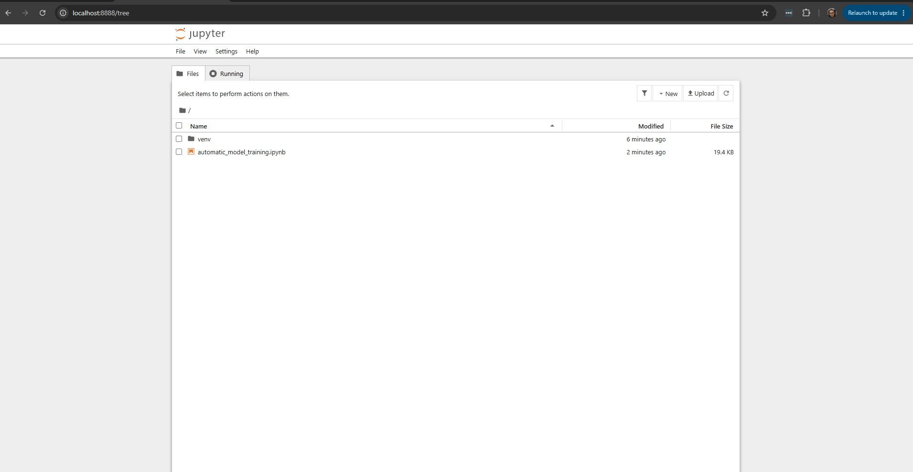

# Wake word

The robot listens for a wake word with [openWakeWord](https://github.com/dscripka/openWakeWord), on the Pi
and offline. It ships with the reliable stock **"hey jarvis"** (`models/hey_jarvis.onnx`) and a custom
**"hey richard"** (`models/hey_richard.onnx`), and `ROBOT_WAKEWORD_MODEL` picks one. This page covers tuning
it and training your own.

## Tuning it

While it listens, the robot logs a line every 15 s or so, and the score on every hit:

```
wake: still listening -- best score=0.41, loudest=12730 (...)
```

`best score` is how close it came (compare it with `ROBOT_WAKEWORD_THRESHOLD`, 0.4); `loudest` is the
loudest audio it heard, out of 32767.

- **Set the microphone level first.** It's the biggest lever. Too quiet gives low scores, but too loud clips,
  and clipped audio scores close to 0, which looks like a broken model. Aim for `loudest` between about 8,000
  and 22,000 when you speak. Find the mic's card with `arecord -l` (say card 2), then:
  ```bash
  amixer -c 2 sset 'Auto Gain Control' off    # if it has one
  amixer -c 2 sset Mic 60%                     # lower if loudest nears 32767, higher if under ~4000
  sudo alsactl store                           # keep the level after a reboot
  ```
  On one build the mic clipped at 100% (`loudest=31897`, score 0.00) and woke reliably at about 70%.
- **Score just under the threshold:** lower `ROBOT_WAKEWORD_THRESHOLD` to 0.3. A score of exactly 0.00
  means the audio is the problem, not the threshold.
- **It wakes by itself:** raise the threshold, or set `ROBOT_WAKEWORD_TRIGGER_LEVEL=2`.
- **Wrong microphone:** set `ROBOT_WAKEWORD_DEVICE` to part of the mic's name. `./scripts/setup_audio.sh`
  sets it for you.
- **Say it cleanly:** from 15 to 20 cm away, at normal volume, half a second after `listening` appears.

Apply changes with `./scripts/run_me.sh --reload`.

## Training your own

Training makes thousands of synthetic recordings of your phrase, mixes in background noise and trains a small
detector. You never record your own voice, so it works for anyone who says the phrase. You train once, on
Google Colab or a PC (never the Pi), and copy the resulting `.onnx` file to the robot.

**Pick a phrase of three or more syllables**, like "hey richard". A short name such as "richard" alone fires on
ordinary speech.

The training recipe is a Jupyter notebook: a page of code "cells" you run one at a time, top to bottom, with
Shift+Enter. Cells share memory, so order matters.



### On Google Colab (easiest)

Works from any computer with a browser, on Google's free GPU.

1. Open https://colab.research.google.com/github/dscripka/openWakeWord/blob/main/notebooks/automatic_model_training.ipynb
   and sign in.
2. **Runtime > Change runtime type > T4 GPU > Save.**
3. In the config cell that starts `config["target_phrase"] = ["hey sebastian"]`, change only that line:
   `config["target_phrase"] = ["hey richard"]`.
4. **Runtime > Run all**, and leave the tab open for 30 to 60 minutes.
5. In the file browser on the left, open `my_custom_model/` and download `hey_richard.onnx`. If the last cell
   errors, ignore it: it only makes a `.tflite` you don't need.

### On your own PC (Linux, or WSL on Windows)

The notebook needs Python 3.10 and about 25 GB of free disk. Work in the repo's scratch folder, which git
ignores:

```bash
cd ~/LocalAiRobot/tools/wakeword-training
sudo apt install -y python3.10 python3.10-venv python3.10-dev git wget ffmpeg   # on Ubuntu 24.04, add the deadsnakes PPA first
python3.10 -m venv venv && source venv/bin/activate
pip install jupyter
wget https://raw.githubusercontent.com/dscripka/openWakeWord/main/notebooks/automatic_model_training.ipynb
jupyter notebook --no-browser       # open the printed localhost link
```

Run the cells one by one (not Run All): edit the phrase in the second config cell before running it, and skip
the last cell (`convert_onnx_to_tflite`). Yellow warnings are harmless; only a red `Traceback` matters. The
model lands at `tools/wakeword-training/my_custom_model/hey_richard.onnx`. Afterwards,
`git clean -dfx tools/wakeword-training` gets the 20 GB back.

### When the notebook breaks

The notebook is a few years old, so newer packages break it, on Colab too. Fix each in a new cell above the
one that failed, then **Kernel > Restart Kernel** and re-run from the Imports cell (never the big install cell):

| Error | Fix |
|---|---|
| `module 'pyarrow' has no attribute 'PyExtensionType'` | `!pip install "pyarrow==14.0.1"` |
| `compiled using NumPy 1.x cannot be run in NumPy 2.x` | `!pip install "numpy<2"` |
| `module 'torchaudio' has no attribute 'set_audio_backend'` | `!pip install "torch==2.0.1" "torchaudio==2.0.2"` |
| `No module named 'generate_samples'` | re-clone piper-sample-generator at `v2.0.0` (below) |
| `404 Not Found` for an AudioSet file | carry on, and set `config["background_paths"] = ['./fma']` |
| a protobuf `Traceback` after training | ignore it: the `.onnx` was already saved |

```python
!rm -rf piper-sample-generator
!git clone https://github.com/rhasspy/piper-sample-generator
!cd piper-sample-generator && git checkout v2.0.0
!wget -q -O piper-sample-generator/models/en_US-libritts_r-medium.pt https://github.com/rhasspy/piper-sample-generator/releases/download/v2.0.0/en_US-libritts_r-medium.pt
```

### A stronger model, or another phrase

The notebook's defaults are quick demo settings. For better accuracy, change these in the config cell (it
takes hours):

```python
config["n_samples"] = 30000
config["n_samples_val"] = 2000
config["steps"] = 50000
```

To re-run, or train another phrase, run the Imports cell, both config cells, then the three training steps.
Add `--overwrite` to the augment step, or it reuses the previous run's features:
`!{sys.executable} openwakeword/openwakeword/train.py --training_config my_model.yaml --augment_clips --overwrite`.

## Put it on the robot

Copy the model into `models/`, commit it and pull it on the Pi:

```bash
cp tools/wakeword-training/my_custom_model/hey_richard.onnx models/   # or your download from Colab
git add models/hey_richard.onnx && git commit -m "New wake word model" && git push
```

On the Pi, `git pull`, set `ROBOT_WAKEWORD_MODEL=~/LocalAiRobot/models/hey_richard.onnx` in `config/robot.env`,
and `./scripts/run_me.sh --reload`. Say the phrase and look for `wake: 'hey_richard' detected` in the log. To
test without committing, `scp` the file into `~/LocalAiRobot/models/` instead.
