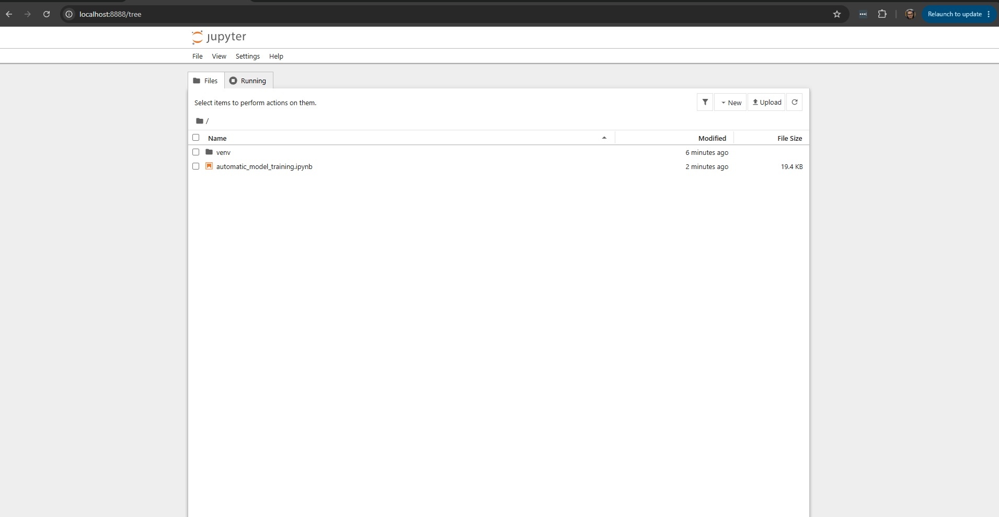

# Training your own "Wake" word to activate your robot

Your LocalAiRobot listens for a **wake word** — a name you say to get its attention before a command,
just like *"Hey Siri"* or *"Alexa"*. Out of the box it uses a stock phrase such as **"hey jarvis"**.
This guide shows you how to make your **own** wake word — say, **"hey Richard"** — so the robot wakes to
a name you choose. You only do this **once**, and **not on the Pi** — you do it on a PC (or in the cloud)
and copy the result over.

## What we're actually doing (plain English)

To create a custom wake word we use a free, open-source library called **openWakeWord**. You can't just
record yourself a few times — instead, openWakeWord:

1. **Invents thousands of spoken examples** of your phrase using a text-to-speech voice generator (so you
   don't have to say it 1,000 times yourself).
2. **Mixes in** background noise, music and room echo, so the detector learns to hear your phrase in the
   messy real world.
3. **Trains a tiny detector** — a small file that, given live microphone audio, answers one question:
   *"did I just hear the phrase — yes or no?"*

> **"Wait — do I ever record my own voice?"** **No** — and that's the point. The text-to-speech generator
> invents the spoken examples for you, in many synthetic voices, so the model learns the **sound pattern
> of the words** ("hey richard") rather than one person's voice. It therefore recognises **anyone** saying
> it live, including you. *(Trade-off: it's speaker-**independent** — great for any voice, but never tuned
> to *yours* specifically, which is what the `ROBOT_WAKEWORD_THRESHOLD` / `TRIGGER_LEVEL` knobs are for.)*

You run this recipe inside **Jupyter** — a web app that shows code as a list of "cells" you run one at a
time, right in your browser. It looks like this:



The end result is a single small file ending in **`.onnx`** (e.g. `hey_richard.onnx`). **That `.onnx`
file *is* the wake word.** You copy it onto the Pi, point one config line at it, and you're done — it then
runs **100% offline** on the robot forever. Training is the only step that needs a powerful computer and
the internet.

## Jupyter basics — what "cells" are (read once)

A Jupyter **notebook** is a document made of **cells** — small boxes you run one at a time. Most hold
code (Python, or a shell command). The label to the **left** of a code cell shows its state: **`[ ]`** =
never run, **`[*]`** = running now, **`[5]`** = finished (the number is the order it ran in).

> **Golden rule: cells share memory and run top-to-bottom.** A variable, import, or installed package
> from an earlier cell stays available to later ones — so **the order you run cells matters**, and a cell
> **stops at its first error** (later lines in *that* cell don't run). This is why a fix must be its own
> cell placed **above** the cell that needs it.

- **Run a cell:** click it (a coloured bar marks the selected cell) → **Shift+Enter** (runs it, moves to
  the next). Let `[*]` turn into a number before running the next. Always go **top to bottom**.
- **Add a cell in the right place:** first **click the cell you want the new one to come *after*** — then
  the toolbar **`+`** drops an empty cell **directly below** it. (Got it in the wrong spot? Select it and
  use the toolbar **↑ / ↓** to move it.)
- **A line starting with `!`** runs a shell command *inside that cell* (e.g. `!pip install …`) — in the
  **browser notebook, NOT** your terminal. That's how you install fixes mid-recipe.
- **Restart memory:** menu **Kernel → Restart Kernel** (needed after replacing a package mid-session). A
  restart **only wipes memory** — it does **not** clear old red error text or re-run anything. The old
  output stays on screen until you **re-run the cell yourself**; you know a cell actually re-ran when its
  number changes (after a restart, counts start over at `[1]`).
- **Server vs browser:** in Path B the **server** runs in your **terminal** (don't close it) and the
  notebook is the **browser** tab; in Path A both live in Google's cloud. **Lost the tab?** Path B: reopen
  the `http://localhost:8888/?token=…` link from your terminal (or run `jupyter notebook list`).
- **Stop for the day (Path B):** press **Ctrl+C** in the server terminal, then `y`. *(One Ctrl+C asks
  "Shut down this Jupyter server (y/[n])?" — answer **n** to keep working, **y** to stop.)*

## Step 0 — pick your phrase

- Use **3+ syllables** — e.g. *"hey Richard"*, **not** just *"Richard"*. Short names false-trigger
  constantly on ordinary speech (the model has too little sound pattern to lock onto).
- Keep it lowercase and simple. This also becomes the model's file name.
- **Insist on a short, 2-syllable name** (e.g. just *"richard"*)? You can, but expect more false fires and
  weaker detection. Help it by training more: `config["n_samples"] = 5000` and `config["steps"] = 20000`
  (slower); then on the robot raise `ROBOT_WAKEWORD_TRIGGER_LEVEL` to `2` and `ROBOT_WAKEWORD_THRESHOLD`
  (e.g. `0.6`) to suppress false triggers. If it's still twitchy, go back to a 3-syllable phrase.

## Two ways to do the training

| | **Google Colab** (recommended) | **Your own PC** (Linux / Windows WSL) |
|---|---|---|
| Setup | none — runs in your browser | install Python 3.10 + tools |
| Speed | ~30–60 min on a free GPU | hours on CPU; fast with an NVIDIA GPU |
| Best for | most people, first time | doing it fully offline / repeatedly |

> ⚠️ **Which OS?** **Path A (Colab) works for everyone — Mac, Windows, or Linux** (it's just a browser).
> Local training (Path B) needs **Linux**: on **Windows** use **WSL** (Windows Subsystem for Linux); on
> **macOS** local training is untested (the voice generator targets Linux), so **Mac users should use
> Colab**. Either way **don't train on the Pi** — its ARM chip can't install the tools and it'd be
> painfully slow. Train on a PC or Colab, then copy the small `.onnx` to the Pi.

---

## Path A — Google Colab (easiest, nothing to install)

**What's Colab?** Google Colab is a free service that runs Jupyter notebooks **in your browser, on
Google's computers** (with a free GPU) — nothing to install on your own machine. It can open **any**
notebook that lives on GitHub.

1. Open the training notebook in Colab with this **direct link**:
   ```
   https://colab.research.google.com/github/dscripka/openWakeWord/blob/main/notebooks/automatic_model_training.ipynb
   ```
   Sign in with a Google account. *(Some notebooks show a clickable "Open in Colab" button — a "badge" —
   at the top on GitHub, but this one doesn't, and you don't need it: Colab builds that link from the
   GitHub path — `colab.research.google.com/github/<owner>/<repo>/blob/<branch>/<path>` — so it works
   either way.)*
2. In Colab: **Runtime → Change runtime type → T4 GPU → Save**.
3. Find the config cell that starts `config["target_phrase"] = ["hey sebastian"]` and change **just the
   phrase line**:
   ```python
   config["target_phrase"] = ["hey richard"]
   ```
   The line right below it auto-names the model from your phrase (`hey_richard`) — leave that one alone.
4. **Runtime → Run all.** It downloads data, generates samples, and trains (~30–60 min). Leave the tab open.
5. When it finishes, open the file browser (📁 icon, left side) → folder `my_custom_model/` → download
   **`hey_richard.onnx`**. *(If the very last cell shows an error, ignore it — it only makes a `.tflite`
   you don't need; your `.onnx` was already saved.)*

Now jump to **"Put it on your robot"** below.

---

## Path B — Your own PC (Linux or Windows WSL)

> On Windows, do everything inside **WSL**: open a terminal and type `wsl`. Ubuntu **22.04** already has
> Python 3.10; Ubuntu **24.04** needs the extra "deadsnakes" step shown below.

1. **Work inside the repo, and get Python 3.10** (the notebook needs exactly this version). The repo
   ships a **gitignored scratch folder — `tools/wakeword-training/`** — for exactly this, so the trained
   model ends up one `cp` from `models/` (no separate `~/oww`, no `scp` to the Pi). From your repo clone
   on the training PC/WSL:
   ```bash
   cd ~/LocalAiRobot/tools/wakeword-training     # (adjust if you cloned the repo elsewhere)
   # On Ubuntu 24.04 only (skip on 22.04): add Python 3.10
   sudo apt install -y software-properties-common
   sudo add-apt-repository -y ppa:deadsnakes/ppa && sudo apt update
   sudo apt install -y python3.10 python3.10-venv python3.10-dev git wget ffmpeg
   ```
2. **Create the environment and install Jupyter:**
   ```bash
   python3.10 -m venv venv && source venv/bin/activate
   python --version          # must print 3.10.x
   pip install jupyter
   ```
3. **Download the recipe and start Jupyter:**
   ```bash
   wget https://raw.githubusercontent.com/dscripka/openWakeWord/main/notebooks/automatic_model_training.ipynb
   jupyter notebook --no-browser
   ```
   Copy the printed `http://localhost:8888/...?token=...` link into your browser. (If you typed plain
   `localhost:8888` and it asks for a token, copy the long value after `token=` from the terminal into the
   box.) *(Closed the terminal and come back later? Re-activate first:
   `cd ~/LocalAiRobot/tools/wakeword-training && source venv/bin/activate`, then
   `jupyter notebook --no-browser` again — otherwise you'll be using the wrong Python.)*
4. **Open** `automatic_model_training.ipynb`. Run cells **one at a time, top to bottom** with
   **Shift+Enter**, letting each finish (`[*]` → a number) before the next. **Don't use Run → Run All** —
   you must edit the config cell first (Step 5) and you skip the last cell (Step 6). The first cell
   installs PyTorch etc. (~10 min); the data cells download **~20 GB** — the precomputed-features file alone
   is **~16 GB**, so have **~25 GB free** (`df -h ~`) or the download dies partway. **After any Kernel → Restart,
   resume from the *Imports* cell downward — do NOT re-run that first big install cell; it errors trying
   to re-create a folder it already made.**
5. **There are two config cells.** Run the **first** (`config = yaml.load(...)`) as-is — it loads the
   defaults. In the **second** (it starts `config["target_phrase"] = ["hey sebastian"]`), change **just
   the phrase line *before* running it**:
   ```python
   config["target_phrase"] = ["hey richard"]
   ```
   The next line auto-names the model `hey_richard` from your phrase — leave it alone. (Optional: raise
   `config["n_samples"]` to `5000` for a stronger model — slower.)
6. Run the training cells (generate → augment → train). Two things not to panic about: training runs in
   **several "sequences"** (`Starting training sequence 1…`, then 2, 3 — a multi-cycle technique, not a
   loop; let them all finish), and you'll see a **wall of yellow warnings** (`torchvision is not
   available`, `kaiser_window … deprecated`, `FutureWarning … output_type`, `float64 → float32`) — all
   **harmless**; only a red `Traceback` matters. Keep the machine **awake** (it's the long part). **Skip
   the very last cell** (`convert_onnx_to_tflite`) — it's a Colab-only retry hack; the train step already
   saved the `.onnx`, which is all the robot needs.
7. When training fully finishes, the model lands at
   **`tools/wakeword-training/my_custom_model/hey_richard.onnx`** (a **file**, already inside your repo
   clone). *Heads-up: the `my_custom_model/hey_richard/` **folder** beside it is just the intermediate
   clips + features — that is **not** the model; the `.onnx` only appears once `--train_model` completes
   all its sequences.* Confirm with `find my_custom_model -name "*.onnx"` (from the workspace). Browse it
   from Windows with `explorer.exe .` (run from the workspace) or
   `\\wsl$\Ubuntu\home\<you>\LocalAiRobot\tools\wakeword-training`. **After you copy the `.onnx` to
   `models/` (next section), reclaim the ~20 GB: from the repo root, `git clean -dfx tools/wakeword-training`
   (keeps the tracked README/.gitignore).**

> 🔧 **Common errors — a too-new package vs the notebook's old pins.** The notebook pins old library
> versions, and pip pairs them with *newer* core packages that break them. You'll see one of:
> - (on the **Imports** cell) `module 'pyarrow' has no attribute 'PyExtensionType'`
> - (on the **Imports** cell) `A module that was compiled using NumPy 1.x cannot be run in NumPy 2.x` /
>   `numpy.core.multiarray failed to import`
> - (on the **step-5 training cells**) `module 'torchaudio' has no attribute 'set_audio_backend'` — pip
>   installed a *newer* torch/torchaudio than the pinned `torch_audiomentations==0.11.0` expects.
>
> **Fix — the same three steps each time, done *inside the notebook* (don't touch the terminal):**
> 1. Add a **separate new cell** (toolbar **`+`**) with **only** the matching downgrade, and run it
>    (**Shift+Enter**) — *don't append it to a code cell; a cell stops at its first error, so the install
>    line would never run:*
>    - pyarrow error → `!pip install "pyarrow==14.0.1"`
>    - numpy error → `!pip install "numpy<2"`
>    - torchaudio error → `!pip install "torch==2.0.1" "torchaudio==2.0.2"`
> 2. Menu **Kernel → Restart Kernel** (required — the broken version is already loaded in memory). The old
>    red error stays on screen after a restart; that's normal — it clears only when you re-run the cell.
> 3. Re-run the cell that failed (the **Imports** cell for pyarrow/numpy; the **step-5** cells for
>    torchaudio). **Expect to do this a few times** — fixing one too-new package can reveal the next
>    (pyarrow → numpy → torch). It's tedious, not broken. *(After a restart, always **re-run the Imports
>    cell first** — the step-5 cells use `sys` from it, so skipping it gives `/bin/bash: {sys.executable}:
>    command not found`. And don't re-run the big first install cell — it errors on a folder it already made.)*
>
> Tip: check a package's version in a cell with `import numpy; print(numpy.__version__)`. **Note:** this
> notebook is a couple of years old, so it needs these downgrades to run in any current environment —
> Colab's environment has also moved on since, so **Path A may need the same fixes**. It's just the cost
> of an aged notebook; once it imports cleanly, the training itself is reliable.

> 🌐 **A data-download cell shows `404 Not Found` (e.g. AudioSet `bal_train09.tar`, then `tar: This does
> not look like a tar archive`, then `0it`).** Some files this 2-year-old notebook points at have moved on
> their host. It is **non-fatal** — the cell still grabs the other background audio (FMA), and the main
> training data (the precomputed `ACAV100M` features) comes from a *separate* cell. **Just carry on.**
> Because it leaves `./audioset_16k` **empty**, change one line in the section-4 config cell so the augment
> step still has background audio: `config["background_paths"] = ['./fma']` (drop the empty folder; `./fma`
> still has clips). The model then trains fine, perhaps wanting a little threshold tuning later. *(Want the
> extra noise data anyway? Edit the download cell and try a shard that still exists, e.g.
> `bal_train09.tar` → `bal_train00.tar`.)*

> 🌀 **Step 1 (`--generate_clips`) fails with `ModuleNotFoundError: No module named 'generate_samples'`.**
> The `piper-sample-generator` repo (cloned in cell 1) has been **rewritten into a package** since this
> notebook was written, so current `main` no longer has the flat `generate_samples.py` the notebook
> imports. Re-clone the version the notebook expects (the **v2.0.0** release it pulls its voice model
> from), in a new cell:
> ```python
> !rm -rf piper-sample-generator
> !git clone https://github.com/rhasspy/piper-sample-generator
> !cd piper-sample-generator && git checkout v2.0.0
> !wget -q -O piper-sample-generator/models/en_US-libritts_r-medium.pt https://github.com/rhasspy/piper-sample-generator/releases/download/v2.0.0/en_US-libritts_r-medium.pt
> ```
> Verify with `import os; print(os.path.isfile("piper-sample-generator/generate_samples.py"))` (should be
> `True`), then re-run Step 1.

> ✅ **Step 3 ends with a scary red `Traceback` (`TypeError: Descriptors cannot be created directly` /
> protobuf / tensorflow) — but your model already saved.** After training, `--train_model` *automatically*
> tries to also make a `.tflite`, and that conversion fails on this aged stack (a protobuf
> incompatibility). **Ignore it.** Just above the traceback you'll see
> `Saving ONNX mode as '…/my_custom_model/hey_richard.onnx'` — that succeeded. Confirm with
> `ls -la my_custom_model/hey_richard.onnx` (from the workspace); the robot only needs the `.onnx`. *(Low **Recall** in
> the final metrics? The model works but is a baseline — lower `ROBOT_WAKEWORD_THRESHOLD` on the Pi, or
> retrain with `n_samples=5000` / more steps.)*

---

## Put it on your robot

The model is on the machine you **trained** on; the robot is the **Pi**. The robot already points
`ROBOT_WAKEWORD_MODEL` at **`models/hey_richard.onnx`** in the repo, so deploying is just dropping your new
model there. Two ways — pick one. (Replace `ramesh` / the IP with yours.)

**Option A — commit it to the repo (recommended; it becomes the default).** Because you trained **inside
the repo** (Path B), the model is already in your clone — copy it onto the shipped default and commit; the
Pi picks it up on `git pull`, no config edit. From the **repo root** on your training PC:
```bash
cp tools/wakeword-training/my_custom_model/hey_richard.onnx models/hey_richard.onnx
git add models/hey_richard.onnx && git commit -m "Update hey_richard wake model" && git push
```
*(Trained in Colab / Path A instead? Copy your downloaded file in: `cp ~/Downloads/hey_richard.onnx models/`.)*
Then on the Pi:
```bash
cd ~/LocalAiRobot && git pull && ./scripts/run_me.sh --live
```
*(A wake `.onnx` is ~200 KB — committed via the `!models/*.onnx` exception in `.gitignore` (`*.onnx` is
ignored everywhere else), and `.gitattributes` marks it `binary` so it isn't line-ending-mangled. To ship
it under a different name, copy it as e.g. `models/hey_ramesh.onnx` and point `ROBOT_WAKEWORD_MODEL` there.)*

**Option B — scp it (quick test, no commit).** Copy straight onto the Pi's already-wired path **by IP**
(WSL2 usually can't resolve `.local` mDNS names). Get the Pi's IP on the Pi with `hostname -I`
(e.g. `192.168.68.122`), then from the repo root on your PC/WSL:
```bash
PI=192.168.68.122      # ← your Pi's IP from `hostname -I`
scp tools/wakeword-training/my_custom_model/hey_richard.onnx ramesh@$PI:~/LocalAiRobot/models/hey_richard.onnx
```
It lands on the default path, so there's no config to edit — on the Pi just `./scripts/run_me.sh --live`.

**Test it.** Say **"hey Richard"** → you should see `wake: 'hey_richard' detected (score=…)` in the log.

**If it misbehaves — tuning the wake word.** While it listens, the robot logs a tuning read-out every
~15 s (and the score on every hit): `wake: still listening -- best score=0.41, loudest=12730 (...)`.
Tune by those two numbers — **`best score`** (vs your threshold) and **`loudest`** (the captured audio
peak, max 32767). Edit `config/robot.env` or run `amixer`, then re-run `--live`:

- **Mic capture gain — the biggest real-world lever, and the most surprising.** A cheap USB mic is often
  too quiet (low scores) *or*, cranked to max, **clips** — and clipped/distorted audio makes the score
  **collapse to ~0**, which looks exactly like "the model is broken." Aim for `loudest` peaking
  **mid-scale (~8,000–22,000)** when you speak — never near 32767. Find the mic's card with `arecord -l`
  (e.g. card 2), then:
  ```bash
  amixer -c 2 sset 'Auto Gain Control' off    # if present -- stops AGC pumping the level into clipping
  amixer -c 2 sset Mic 75%                     # then nudge: DOWN if 'loudest' nears 32767, UP if < ~4000
  ```
  *(Real example: at 100% the mic clipped — `loudest=31897`, `best score=0.00`; at ~70–75% it landed
  `loudest≈12000` and detected at `score=0.68`.)*
- **Doesn't wake, and `best score` sits just under your threshold** → lower `ROBOT_WAKEWORD_THRESHOLD`
  (e.g. `0.3`, then `0.2`). *But if the misses show `best score=0.00` (not ~0.18), the **audio** is the
  problem — fix the gain above; a lower threshold won't help a sound the model never heard.*
- **Fires at random speech** → raise `ROBOT_WAKEWORD_THRESHOLD`, or `ROBOT_WAKEWORD_TRIGGER_LEVEL` to `2`.
- **Wrong / silent microphone** → set `ROBOT_WAKEWORD_DEVICE` to your mic's index from
  `brain/.venv/bin/python -c "import sounddevice as sd; print(sd.query_devices())"`.
- **Say it cleanly** — ~15–20 cm, normal volume, and give a half-second *after* `listening` prints (the
  model needs to fill its audio buffer first; saying it the instant listening starts often misses).

**Swapping models later:** drop another `.onnx` in `models/` and re-point that one `ROBOT_WAKEWORD_MODEL`
line (several can live there side by side); overwrite `hey_richard.onnx` to change the default. The robot
code never changes.

---

## Make it stronger, or train another phrase

> ♻️ **Re-running the recipe** (changing parameters, training a new phrase, or just coming back after a
> break): you only re-run the **tail** of the notebook — *never* the big first install cell or the ~20 GB
> data downloads (all still on disk). Cells share memory, so re-establish it **in this exact order**, then
> run training:
> 1. **Imports** cell — re-defines `yaml`, `sys`, … *(skip it → `/bin/bash: {sys.executable}: command not found`)*.
> 2. **First config cell** (`config = yaml.load(...)`) — re-defines `config` *(skip it → `NameError: name 'config' is not defined`)*.
> 3. **Your edited config cell** (the `config["target_phrase"]`/`n_samples`/… one) — rewrites `my_model.yaml`.
> 4. **Step 1 → 2 → 3** (generate → augment → train).

> ⏭️ **On a re-run, Step 2 prints `Openwakeword features already exist, skipping data augmentation and
> feature generation`.** Not an error — but a trap: the augment step found the **feature files from your
> *previous* run** and skipped, so training would silently reuse the **old** clips and ignore the 30k you
> just regenerated. Force it to rebuild them by adding **`--overwrite`** to the Step 2 cell:
> ```python
> !{sys.executable} openwakeword/openwakeword/train.py --training_config my_model.yaml --augment_clips --overwrite
> ```
> Re-run it — instead of the skip line you'll now see `Computing openwakeword features for generated
> samples` and a `Computing features: …%` progress bar (~1875 steps, a few minutes), under the usual wall
> of harmless `FutureWarning … output_type` / `float64 → float32` warnings. When it reaches 100%, run Step 3.
> *(`--overwrite` only rebuilds the four `my_custom_model/<phrase>/*_features_*.npy` files from your new
> clips — it does **not** re-download or touch the ~16 GB background-features file.)*

**Why is my accuracy only ~70%, and how do I beat 90%?** The notebook ships **demo settings** built for
speed, not quality: `n_samples = 1000`, `steps = 10000`, and lowered targets. **Overwrite** those values
in the config cell (change the numbers in place — don't paste duplicates; keep `target_phrase`,
`background_paths`, etc.):
```python
config["n_samples"]       = 30000   # far more synthetic voices (was 1000) — the biggest lever
config["n_samples_val"]   = 2000
config["steps"]           = 50000   # the trainer's own default (was 10000)
config["target_accuracy"] = 0.7     # checkpoint-selection bar, not a guarantee
config["target_recall"]   = 0.5
```
Then **re-run the recipe** (the ♻️ sequence above). Two things to expect: **generate resumes** — it tops
your existing clips up to the new target rather than redoing them, but at 30k it's now the long part (an
**hour+**, plus 50k training steps — a multi-hour run); and training **overwrites** the previous `.onnx`
(your deployed baseline on the Pi is untouched). **No magic number** — this lifts accuracy a lot but
**95% isn't guaranteed**; if it falls short, push `n_samples` higher still and add more background noise.
(Runtime threshold tuning trades recall vs. false-positives but can't replace a better model.)

**Train another phrase (e.g. "hey ramesh"):** nothing re-downloads or re-installs — the data is all on
disk. Edit `config["target_phrase"] = ["hey ramesh"]` in the config cell, then **re-run the recipe** (the
♻️ sequence above). Out comes a **separate** `my_custom_model/hey_ramesh.onnx`; your existing model is
untouched. The robot uses **one** wake model at a time (swap via `ROBOT_WAKEWORD_MODEL`); to wake on
**several** phrases with a single model, list them together:
`config["target_phrase"] = ["hey richard", "hey ramesh"]`.
