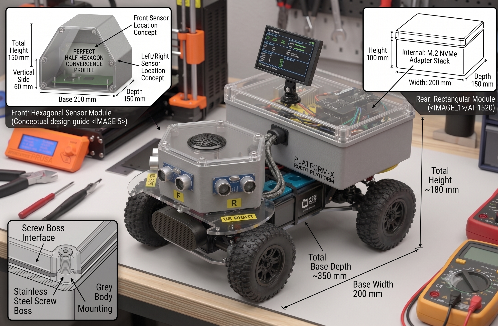
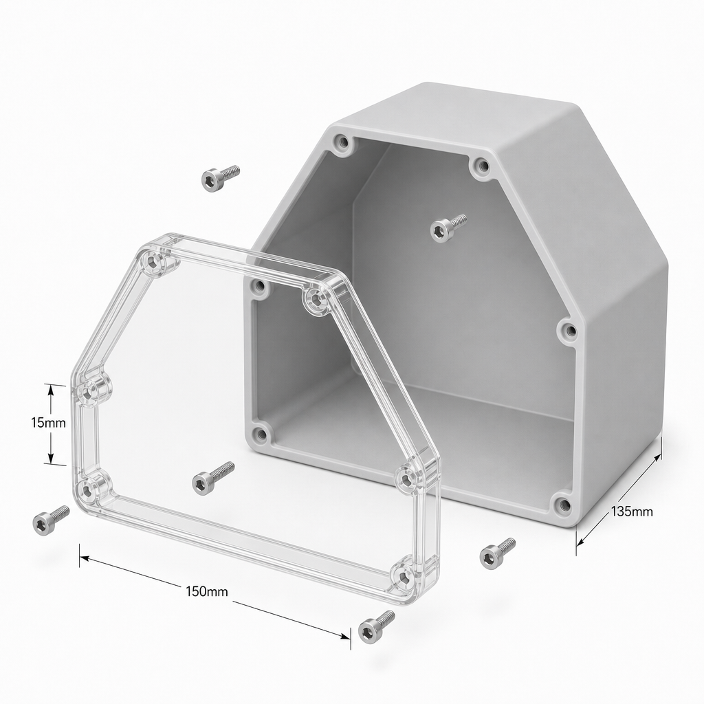
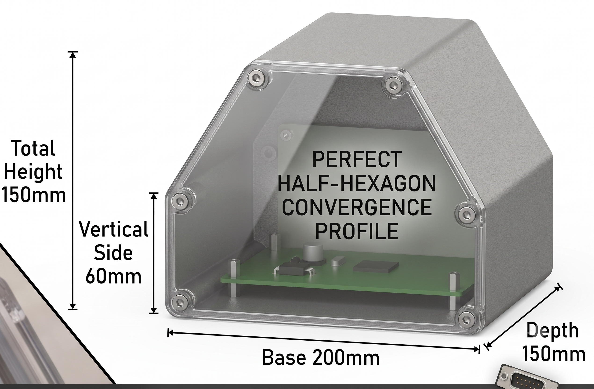
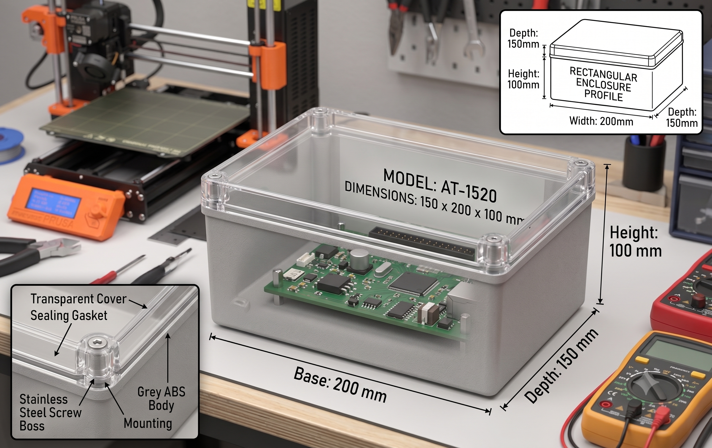

# Parts

Everything the reference builds use, with search terms for any retailer. Want the same items in one go? They're
collected in this [AliExpress wishlist](https://www.aliexpress.com/p/wish-manage/share.html?spm=a2g0o.productlist.headerAcount.6.5b533bbc853DSK&smbPageCode=wishlist-amp&spreadId=EAF81BDA069358563ED6BEBC329A18554A43DABDD29B2526E03A87F05A681D99).
Listings change, so check each one against the notes here before you order.

Different hardware is fine: each alternative ESC, camera, sensor, IMU or encoder has a one-command patch that
writes its settings. See the [patch list](../scripts/patches/README.md).

## Brain, power and sound

| Part | Search term | Notes |
|---|---|---|
| Raspberry Pi 5, 16 GB | `Raspberry Pi 5 16GB` | the brain |
| Active cooler | `Raspberry Pi 5 active cooler` | required: the Pi throttles under the language model without it |
| Official PSU, 27 W | `Raspberry Pi 5 27W USB-C power supply` | for building and bench testing |
| microSD or NVMe | `high-endurance microSD 64GB` | NVMe loads the models much faster |
| UPS HAT | `Raspberry Pi 5 UPS HAT 18650 pogo pin` | pogo-pin, bottom-mount (e.g. Geekworm X1200/X1202), so the 40-pin header stays free |
| 2× 18650 cells | `18650 flat-top high-drain 3000mAh` | genuine Samsung or Sony, if the UPS doesn't include them |
| USB microphone | `mini USB microphone` | |
| USB speaker | `mini USB powered speaker stereo` | USB-powered, so it needs no extra supply. Any USB speaker works. |
| Exhaust fan (optional) | `5V blower fan` + `logic-level N-channel MOSFET` | only for a sealed box, see [assembly](assembly.md#7-build-the-chassis) |

## Camera and face

| Part | Search term | Notes |
|---|---|---|
| Camera | `USB webcam 1080p` or `1080p USB camera module IR-CUT night vision 3.6mm` | USB, not the CSI ribbon. The IR-CUT module sees in the dark, in greyscale. |
| IR illuminator (optional) | `850nm IR LED illuminator board` | only for night vision without other light |
| Face screen, pick one | `3.5 inch USB Type-C secondary screen 320x480 IPS` or `Freenove 5 inch DSI touchscreen 800x480` | USB-C uses the `turing` backend, DSI uses `framebuffer`; it detects either |

## Crawler

| Part | Search term | Notes |
|---|---|---|
| Chassis | `1/10 SCX10 frame all-metal chassis 313mm` | a roller with wheels, which you assemble |
| Motor | `SURPASS 540 brushed motor 35T` | high-turn for torque, not a 13T |
| Pinion | `32P pinion gear 3.175mm 12T` | 32P / M0.8, 12 to 13 teeth, 3.175 mm bore |
| ESC | `60A brushed crawler ESC program card 2-3S` | direct reverse and drag brake (e.g. SURPASS HOBBY 60A) |
| Steering servo | `DSSERVO DS3225 digital servo 180` | 180°, not 270°. **Get the HV (7.4 V) version**: the ESC's 7.4 V supply can burn out a 6 V servo. |
| Battery | `3S 11.1V 5200mAh LiPo Deans` | powers everything; match the plug to your ESC |
| Buck converter | `SZBK07 adjustable buck converter 20A` or `XL4016 9A adjustable buck` | feeds the UPS HAT at 7.4 V. **Set 7.4 V with a multimeter before connecting, never above 8.4 V.** A fixed 5 to 6 V UBEC sags and browns out the Pi ([why](assembly.md#2-power)). |
| Charger | `IMAX B6 lipo balance charger` | always balance-charge a LiPo |
| Plug adapter | `T plug to Tamiya adapter` | only if the ESC and battery plugs differ |
| PWM board | `PCA9685 16 channel servo driver I2C` | makes the ESC and servo signals |
| 3× distance sensor | `HC-SR04P ultrasonic sensor` | the P version runs on 3.3 V, so it needs no level shifter |
| Sensor mount | `HC-SR04 triple sensor bracket` | one sensor ahead, one 45 to 60° left, one right |
| Jumper wires | `dupont jumper wire kit female female` | |

You also need a soldering iron for the PCA9685 headers and the motor plugs. Before you order the chassis, ask
the seller which gearbox you're getting and the spur gear pitch: it must match the pinion (SCX10 standard is
32P / Mod 0.8).

## Greeter

| Part | Search term | Notes |
|---|---|---|
| PIR motion sensor | `HC-SR501 PIR` or `Panasonic EKMB1105112` | **The HC-SR501 needs 5 V; the Panasonic PaPIRs takes 3.3 V and 5 V destroys it.** See [PIR wiring](wiring/pir-sensor-wiring.md). |

The greeter skips the chassis, motor, ESC, servo and distance sensors.

## Enclosures

The electronics can ride in two boxes. The hexagonal front box gives three flat faces for the ultrasonic
sensors (ahead, left and right), with the speaker and microphone behind its clear lid. The rectangular rear
box (about 150 × 200 × 100 mm) holds the Pi, PCA9685, buck converter and UPS, with the face screen on top.
Both have gasketed lids on screw bosses, so you can open them without unmounting anything.

The printable model is in [`docs/enclosure_models/`](enclosure_models/): [`junction_box_body.3mf`](enclosure_models/junction_box_body.3mf)
and [`junction_box_lid.3mf`](enclosure_models/junction_box_lid.3mf). Print them at home or upload both to a
service such as [JLC3DP](https://jlc3dp.com/).

