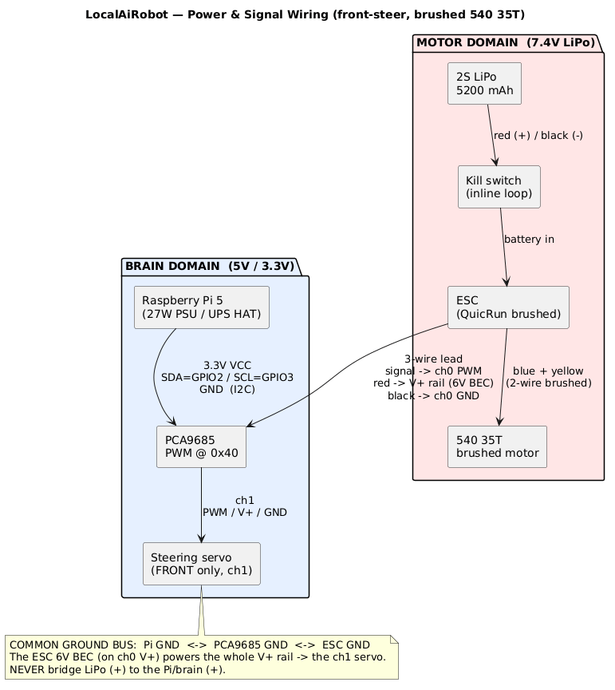
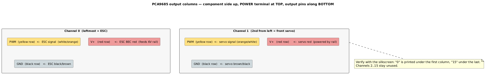

# Wiring Steps — PWM · Servo · ESC · Battery → Pi (last)

This build: brushed **540 35T** motor, a **brushed crawler ESC** (this build uses a SURPASS HOBBY 60A with
a program card; any 2–3S crawler ESC works), **one front steering servo**, a **PCA9685** PWM board (@0x40),
and a **Raspberry Pi 5**. Wire the motor side first (steps 1–4); the Pi I²C goes on **last** (step 5).

> In code: ESC = **ch0**, steering = **ch1** ([config/robot.env:22-23](../../config/robot.env#L22-L23));
> board = I²C **0x40**, **SDA=GPIO2 / SCL=GPIO3** ([brain/driver.py:152](../../brain/driver.py#L152));
> ESC neutral = **1500 µs** ([brain/driver.py:137](../../brain/driver.py#L137)).

---

## What's the PCA9685 (the "PWM board")?

**PWM = Pulse-Width Modulation** — a control signal made of repeating on/off pulses where the **width of
each pulse carries the value**. In RC, a pulse is sent every ~20 ms and its width (≈1.0–2.0 ms, 1.5 ms =
centre) tells the ESC how fast to spin and the servo what angle to hold.

The **PCA9685** is a 16-channel PWM generator on a small breakout board. The Pi sends it short commands
over **I²C** (a 2-wire bus) like "channel 0 = 1500 µs," and the chip then produces that precise, rock-
steady pulse train **in hardware on its own**. That offload matters: the Pi can't bit-bang accurate pulse
timing while it's busy running the LLM, but the PCA9685 never misses a beat. That's why it's called the
"PWM board" — it's the dedicated pulse generator feeding the **ESC (ch0)** and the **steering servo (ch1)**.

---

## Overview

Two power domains — **never bridge their positives, but tie all grounds into one common bus**:

- **Motor:** LiPo → kill switch → ESC → motor. The ESC's **7.4 V BEC** also feeds the PCA9685 **V+ rail**,
  which powers the servo (⚠️ 7.4 V — see the servo-voltage note in step 2).
- **Brain:** Pi 5 → PCA9685 **logic** (3.3 V) + I²C.

PWM only registers if **Pi GND ↔ PCA9685 GND ↔ ESC GND are common**.


<!-- render diagrams/wiring-overview.puml -> images/wiring-overview.png -->

---

## Orient the PCA9685 (applies to steps 2–3)

Hold it **component-side up** (chip facing you), **green POWER terminal along the TOP**, **output pin
rows along the BOTTOM**. Then:

- Output rows, **top → bottom: PWM (yellow) · V+ (red) · GND (black)**.
- Each **column = one channel**. **Leftmost column = ch0**, next column = **ch1** (the board prints a
  tiny `0` under the first column, `15` under the last).
- The `GND OE SCL SDA VCC` header on the short end is the I²C link — wired **last** (step 5).

> **This build uses only the first two columns: `ch0` = ESC, `ch1` = front servo. Channels 2–15 stay
> empty** — the code drives only those two ([config/robot.env:22-23](../../config/robot.env#L22-L23)).


<!-- render diagrams/pca9685-channels.puml -> images/pca9685-channels.png -->

---

## Step 1 — ESC → motor (blue + yellow)

The brushed ESC has **two** motor wires — connect them straight to the motor:

1. ESC **blue** → motor **blue**.
2. ESC **yellow** → motor **yellow**.

This only sets spin **direction**. If forward comes out reversed later: swap these two wires **or** set
`ROBOT_THROTTLE_INVERT=1` ([config/robot.env:33](../../config/robot.env#L33)) — not both. Leave the LiPo
unplugged.


---

## Step 2 — ESC 3-wire lead → PCA9685 **ch0**

The ESC's 3-pin jumper is **white = signal, red = +7.4 V (BEC), black = ground**. Looking at the top side
(POWER terminal up, output pins along the bottom), push it onto the **first column from the left (ch0)**:

- **white (signal)** → **TOP** pin (PWM, yellow row)
- **red (+7.4 V)** → **MIDDLE** pin (V+, red row) — this energises the whole V+ rail
- **black (ground)** → **BOTTOM** pin (GND, black row)

That red wire is what powers the servo in step 3 — you don't need the green POWER terminal.

> ⚠️ **This BEC is 7.4 V, and it feeds the steering servo directly.** Fine for an **HV servo**, but a
> standard DS3225 is rated only to ~6.8 V — confirm yours takes 7.4 V, or **don't** run the ESC's red wire
> into the V+ rail: feed V+ from a separate **5–6 V BEC** instead (the servo's signal on ch1 still comes
> from the PCA9685).

---

## Step 3 — Front servo → PCA9685 **ch1**

Same view — push the servo's 3-pin plug onto the **second column from the left (ch1)**. This servo's lead
is **yellow = signal, red = +V (middle), brown = ground** (its default colours):

- **yellow (signal)** → **TOP** pin (PWM, yellow row)
- **red (+V)** → **MIDDLE** pin (V+, red row)
- **brown (ground)** → **BOTTOM** pin (GND, black row)

If you ever swap to a servo with different colours, go by **position**: signal = top, V+ = middle,
ground = bottom. Front servo only; the rear axle isn't wired.


---

## Step 4 — Battery → ESC (via kill switch)

1. Put the **kill switch / unplug loop on the LiPo → ESC line**, within reach.
2. LiPo to ESC: **red = +, black = −**.
3. Keep the LiPo **unplugged** until step 5 is done and checked.

> 🔴 No hardware watchdog ([brain/driver.py:11-13](../../brain/driver.py#L11-L13)) — the kill switch is
> your real stop. Never join LiPo (+) to anything on the brain side.


---

## Step 5 — PCA9685 logic header → Pi GPIO (LAST)

This short-end header has **6 pins**. What each one is for:

- **`GND`** — ground; the common reference for the chip logic + I²C bus. **Connect.**
- **`OE`** — Output Enable, active-**LOW**. An on-board pull-down already holds it low, so the outputs are
  enabled by default. **Skip — leave open.** (Never tie it HIGH, or *all* PWM outputs go dead.)
- **`SCL`** — I²C clock line. **Connect.**
- **`SDA`** — I²C data line. **Connect.**
- **`VCC`** — 3.3 V power for the chip's logic + I²C. **Connect.**
- **`V+`** — the **servo power rail** (the 7.4 V that drives the servo). **Skip on the Pi side** — it's
  already fed by the ESC's BEC through ch0 (step 2); the Pi must never power it.

**We skip `OE` and `V+`.** Wire the remaining four — PCA9685 pin → Raspberry Pi pin:

| PCA9685 pin | → Raspberry Pi pin |
|---|---|
| `VCC` | **3.3 V** — physical pin 1 |
| `SDA` | **GPIO2 / SDA** — physical pin 3 |
| `SCL` | **GPIO3 / SCL** — physical pin 5 |
| `GND` | **GND** — physical pin 6 |

All four are clustered at the **start of the 40-pin header (pins 1–6)** — locate physical pin 1 (the
corner pin, usually marked with a square pad / `1` on the board) and count from there:


> ⚠️ Use **3.3 V (pin 1)**, *not* the neighbouring **5 V (pins 2/4)** — `VCC` is 3.3 V logic only.

### Confirm the board is detected (`i2cdetect`)

After wiring, on the Pi (over SSH):

```bash
sudo apt install -y i2c-tools     # once, if missing (install_stack.sh normally adds it)
i2cdetect -y 1                    # -y = no prompt;  1 = I²C bus 1 = the GPIO2/3 pins
```

It prints a grid of every address `00`–`77`. A detected PCA9685 shows as **`40`** (row `40`, column `0`):

```
     0  1  2  3  4  5  6  7  8  9  a  b  c  d  e  f
00:                         -- -- -- -- -- -- -- --
...
40: 40 -- -- -- -- -- -- -- -- -- -- -- -- -- -- --
...
70: -- -- -- -- -- -- -- --
```

- **`40` appears** → board is powered and talking on I²C — done.
- **All `--`** → not seen: check `VCC` has 3.3 V, `SDA`/`SCL` aren't swapped, `GND` is common, and that
  I²C is enabled (`sudo raspi-config` → *Interface Options* → *I2C* → enable, then reboot — usually
  already on from `install_stack.sh`).
- A second address **`36`** only shows up if you later fit the UPS HAT (its fuel gauge) — not a conflict.

---

## Step 6 — Ground check & power-up

1. **Continuity (LiPo still out):** Pi GND ↔ PCA9685 GND ↔ ESC GND all common.
2. Power the Pi; confirm `i2cdetect -y 1` → **0x40**.
3. **Wheels OFF the ground**, kill switch in hand, plug in the LiPo. While the brain holds neutral the ESC
   should beep its **cell-count tones then one long "ready" beep**. No long beep = it didn't arm:
   power-cycle the ESC (its switch off/on) while neutral is held and wait for it — cheap ESCs can need a
   couple of tries. Still nothing → recheck ch0 signal + GND and the red BEC on V+.
4. Calibrate per [assembly Phase 8](../assembly.md#phase-8--live-calibration--bring-up-wheels-off-the-ground).

---

## Quick reference

| Connection | From | To |
|---|---|---|
| Motor | ESC blue / yellow | motor blue / yellow |
| Throttle PWM | ESC 3-pin (white / red / black) | PCA9685 **ch0** (PWM / V+ / GND) |
| Steering PWM | front servo 3-pin (yellow / red / brown) | PCA9685 **ch1** (PWM / V+ / GND) |
| Battery | LiPo red / black (via kill switch) | ESC red / black |
| I²C / logic | PCA9685 VCC / SDA / SCL / GND | Pi 3.3V(1) / GPIO2(3) / GPIO3(5) / GND(6) |
| 7.4 V servo power | ESC BEC red (on ch0 V+) | whole V+ rail → ch1 servo |
| Common ground | Pi GND ↔ PCA9685 GND ↔ ESC GND | one bus |

---

**Build order:** the [assembly guide](../assembly.md) sequences *when* to make these connections —
Pi↔PCA9685 logic on the bench in [Phase 3](../assembly.md#phase-3--wire-the-pwm-bridge-pca9685), then
the ESC / motor / LiPo last in [Phase 7](../assembly.md#phase-7--mechanical-build-chassis--mount-everything).
This page is the pin-by-pin reference for all of them.

*Diagrams:* PlantUML sources in [`diagrams/`](diagrams/); render into [`images/`](images/) with
`plantuml -o ../images docs/wiring/diagrams/*.puml` — see [`images/README.md`](images/README.md) for the
part-photo list and the exact render command.
