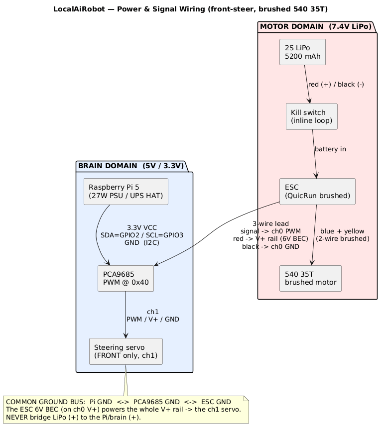
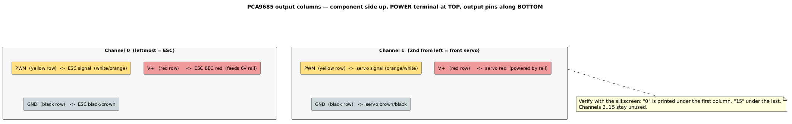
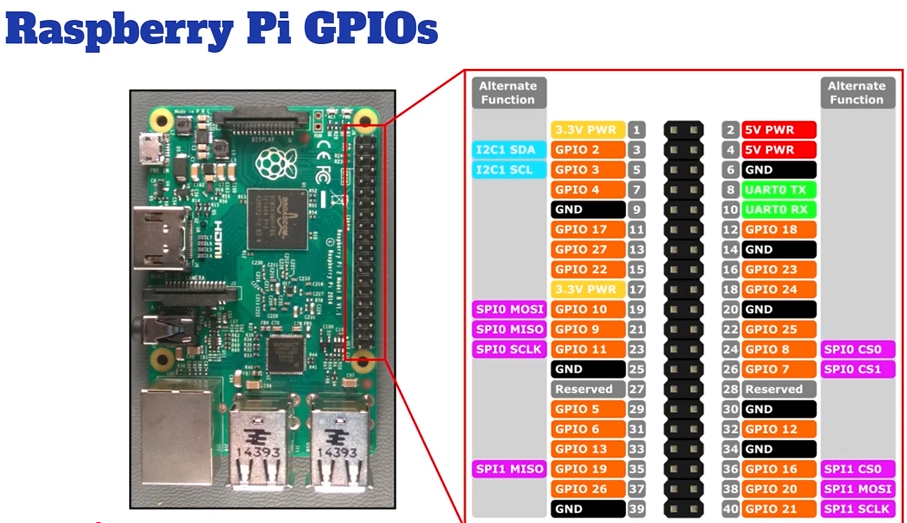

# PWM board, ESC and servo wiring

Pin-by-pin wiring for the drive: the PCA9685 PWM board, the ESC and motor, the steering servo and the battery.
[assembly.md](../assembly.md) says when to make each connection: the Pi to PCA9685 logic in step 3, the rest in
step 7.

The PCA9685 makes the steady timing pulses that set motor speed and steering angle (a pulse every 20 ms, about
1 to 2 ms wide, 1.5 ms for centre). The Pi sends it values over I²C, which matters because the Pi can't time
pulses accurately while it runs the language model.



Power, in short: the LiPo goes through the kill switch to the ESC, whose BEC also powers the servo rail, and to
a buck converter at 7.4 V that feeds the UPS HAT and the Pi. **Never connect the LiPo to the Pi directly, and join
all the grounds** (Pi, PCA9685, ESC, buck converter), or the pulses won't register. Details:
[assembly, power](../assembly.md#2-power).

## Which way round

Hold the PCA9685 chip side up, with the green power terminal at the top and the output pins along the bottom.
The output rows are, top to bottom, signal (yellow), V+ (red) and ground (black). Each column is a channel: the
leftmost is channel 0, and the board prints the numbers underneath.



Two channels are used: one for the ESC and one for the steering servo. The defaults are ESC on 0 and servo on 1;
the reference build's ESC patch sets the ESC to 14. Use whichever columns you like and set `ROBOT_ESC_CHANNEL`
and `ROBOT_STEER_CHANNEL` to match.

## 1. ESC to motor

Connect the ESC's two motor wires to the motor: blue to blue, yellow to yellow. If "forward" later goes
backwards, swap them or set `ROBOT_THROTTLE_INVERT=1`, but not both.

## 2. ESC to the PCA9685

Push the ESC's three-wire lead onto its channel's column: **white (signal) on top, red (7.4 V) in the middle,
black (ground) at the bottom.** The red wire powers the whole V+ rail, which is what feeds the servo, so you
don't need the green power terminal.

**That rail is 7.4 V, and a standard DS3225 is only rated to about 6.8 V.** Use an HV servo, or leave the ESC's
red wire out of the rail and power V+ from a separate 5 to 6 V BEC instead.

## 3. Servo to the PCA9685

Push the servo's plug onto the next column: **yellow (signal) on top, red in the middle, brown (ground) at the
bottom.** With other colours, go by position: signal top, power middle, ground bottom.

## 4. Battery to ESC

Put the kill switch on the LiPo to ESC wire, within reach, then connect red to red and black to black. Leave the
LiPo unplugged until step 5 is checked.

## 5. PCA9685 to the Pi

Wire four pins of the PCA9685's six-pin end header:

| PCA9685 | Raspberry Pi |
|---|---|
| `VCC` | 3.3 V, pin 1 |
| `SDA` | GPIO 2, pin 3 |
| `SCL` | GPIO 3, pin 5 |
| `GND` | ground, pin 6 |

Leave `OE` unconnected (tying it high turns every output off), and never power `V+` from the Pi. **Use 3.3 V
(pin 1), not the 5 V pins next to it.**



Check it with `i2cdetect -y 1`. A grid prints, and the board shows as `40`:

```
     0  1  2  3  4  5  6  7  8  9  a  b  c  d  e  f
40: 40 -- -- -- -- -- -- -- -- -- -- -- -- -- -- --
```

All dashes? Check that `VCC` has 3.3 V, `SDA` and `SCL` aren't swapped, the grounds are joined, and I²C is on
(`sudo raspi-config`, Interface Options, I2C; the installer normally does it). A UPS HAT adds a second address,
`36`.

## 6. Power up

With the LiPo still out, check that the grounds are joined. Then, wheels off the ground and kill switch in hand,
plug in the LiPo and start the robot. The ESC beeps its cell count, then one long "ready" beep while the robot
holds neutral. The rest is in [assembly, first drive](../assembly.md#8-first-drive).

## Quick reference

| Connection | From | To |
|---|---|---|
| motor | ESC blue, yellow | motor blue, yellow |
| throttle | ESC lead (white, red, black) | PCA9685 ESC channel (signal, V+, ground) |
| steering | servo lead (yellow, red, brown) | PCA9685 servo channel (signal, V+, ground) |
| battery | LiPo, through the kill switch | ESC |
| logic | PCA9685 VCC, SDA, SCL, GND | Pi pins 1, 3, 5, 6 |
| ground | Pi, PCA9685, ESC, buck converter | all joined |

The diagrams are drawn from PlantUML sources in [`diagrams/`](diagrams/); [`images/README.md`](images/README.md)
has the render command.
