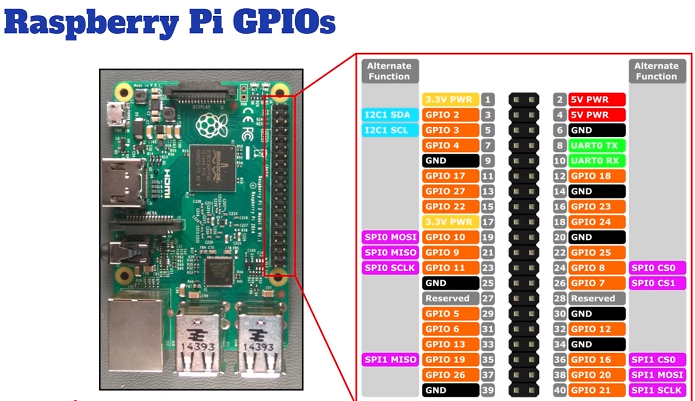

# Ultrasonic sensor wiring

Three HC-SR04P distance sensors across the front: one straight ahead, one 45 to 60° left and one 45 to 60°
right. The front one stops forward driving when something is closer than `ROBOT_OBSTACLE_CM`; the side ones keep
exploring away from walls. They wire straight to the Pi's GPIO pins, with no PCA9685 and no level shifter. This
is step 4 of [assembly.md](../assembly.md).

**Power them from 3.3 V, never 5 V.** The P in HC-SR04P means it runs on 3.3 V, so its echo signal is 3.3 V too,
which is safe for the Pi. On 5 V the echo would be 5 V and damage the Pi.

## Pins

| Sensor | VCC | GND | TRIG (Pi output) | ECHO (Pi input) |
|---|---|---|---|---|
| front | 3.3 V, pin 17 | pin 14 | GPIO 23, pin 16 | GPIO 24, pin 18 |
| left | 3.3 V, pin 17 | pin 34 | GPIO 5, pin 29 | GPIO 6, pin 31 |
| right | 3.3 V, pin 17 | pin 39 | GPIO 20, pin 38 | GPIO 21, pin 40 |



- The Pi has two 3.3 V pins, and pin 1 is the PCA9685's, so share pin 17 between all three sensors. They draw
  very little.
- Any ground pin works; the ones in the table just sit close to each sensor's signal pins.
- Don't mix up which sensor is which: if front and left are swapped, the safety stop watches the wrong way.
- The pins are settings (`ROBOT_TRIG_PIN`, `ROBOT_ECHO_PIN`, `ROBOT_LEFT_*`, `ROBOT_RIGHT_*`). These ones avoid
  I²C, SPI and the serial port; spare pairs are 16/26, 22/27 and 19/25.

## Check them

```bash
./scripts/test_sensors.sh      # Ctrl-C stops it
```

Cover each sensor in turn: only its number should drop, and spring back when you uncover it.

## Good to know

- A sensor that has died and always reads its maximum range looks the same as a clear path, so the software
  can't catch it. **Before trusting it, check that covering the front sensor stops the car.**
- There's no sensor at the back, so reversing is limited only by its speed cap and time limit. Keep
  `ROBOT_MAX_REVERSE_SPEED` low and reverse commands short.
- Only have the 5 V HC-SR04 (no P)? Power it from 5 V and put a divider on each ECHO wire: 1 kΩ from ECHO to the
  GPIO pin and 2 kΩ from that pin to ground. TRIG is fine as it is.
- Laser sensors instead? The VL53L1X patch sets them up: see the [patch list](../../scripts/patches/README.md).
