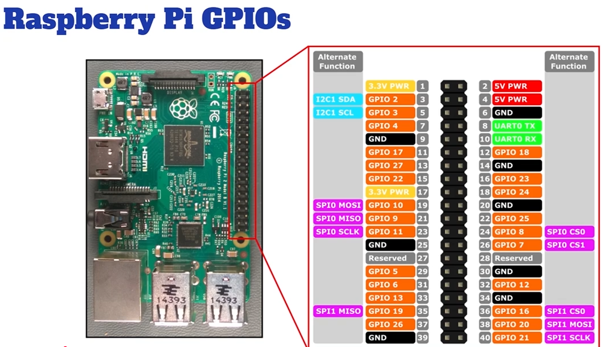

# Wiring Steps — 3× HC-SR04P Ultrasonic Sensors → Pi (direct)

This build uses **three HC-SR04P** distance sensors in a shallow **semi-hex** across the front
(**front**, **~45–60° left**, **~45–60° right**). They wire **straight to the Raspberry Pi's GPIO** — no
PCA9685, no level shifter.

> In code: front **TRIG=GPIO23 / ECHO=GPIO24**, left **5/6**, right **20/21**
> ([config/robot.env:38-45](../../config/robot.env#L38-L45), [brain/driver.py:125-130](../../brain/driver.py#L125-L130)).
> The **front** beam cuts FORWARD under `ROBOT_OBSTACLE_CM`; the **side** beams keep explore-steering off
> near walls under `ROBOT_SIDE_OBSTACLE_CM`.

---

## Yes — these go straight to the Pi (no PCA9685)

The ESC and servo need the PCA9685 because they want a precise PWM pulse train. Ultrasonic sensors don't:
each one just needs **power + two plain GPIO lines** (one out, one in), and `gpiozero` on the Pi does the
timing. So all three connect **directly to the 40-pin header**.

**Why no level shifter:** the **"P"** in HC-SR04**P** means it runs on **3.3 V**, so its `ECHO` output is
already **3.3 V** — safe for the Pi's GPIO (which is **not** 5 V-tolerant). A plain 5 V HC-SR04 would need
a divider — see the fallback near the end.

---

## What's an HC-SR04P / how it works

A 4-pin ultrasonic rangefinder: `VCC · TRIG · ECHO · GND`.

- The Pi pulses **`TRIG`** HIGH for ~10 µs → the sensor emits a burst of 40 kHz ultrasound.
- The sensor then holds **`ECHO`** HIGH for as long as the sound takes to bounce back. Distance =
  (echo-time × speed-of-sound) ÷ 2. `gpiozero`'s `DistanceSensor` measures that pulse for you.

`gpiozero` serialises the three sensors' pings internally so they don't hear each other (~4–6 Hz each); the
control loop just reads the latest cached value, so a sensor never blocks driving.

---

## Overview — the semi-hex front array

Splaying the three beams reduces cone overlap and gives the car left/centre/right awareness:

```
        front
          │
   left   │   right
     \    │    /
      \   │   /        (~45–60° apart)
       \  │  /
        [ car ]
```

- **front** → the safety gate that cuts FORWARD when something's too close ahead.
- **left / right** → keep the explore behaviour from steering into a near wall.

All three share the Pi's **3.3 V** and **GND**; only the TRIG/ECHO pairs are unique per sensor.

---

## The pin map

Each sensor: `VCC`→Pi **3.3 V**, `GND`→Pi **GND**, plus its own `TRIG`/`ECHO`. The GPIO numbers are fixed
by the code; the physical header pins below are a tidy, conflict-free choice.

| Sensor | `VCC` | `GND` | `TRIG` | `ECHO` |
|---|---|---|---|---|
| **front** | 3.3 V — **pin 17** | GND — **pin 14** | GPIO23 — **pin 16** | GPIO24 — **pin 18** |
| **left**  | 3.3 V — **pin 17** (shared) | GND — **pin 34** | GPIO5 — **pin 29**  | GPIO6 — **pin 31**  |
| **right** | 3.3 V — **pin 17** (shared) | GND — **pin 39** | GPIO20 — **pin 38** | GPIO21 — **pin 40** |



> 🔌 **3.3 V, not 5 V.** The Pi has only **two** 3.3 V pins (1 and 17) and pin 1 is the PCA9685's, so
> **bus 3.3 V from pin 17** to all three sensors' `VCC`. (Both 3.3 V pins are the same rail; three
> HC-SR04P draw well under its limit.) Powering from 5 V would push `ECHO` to 5 V and **damage the Pi**.
> `GND` can be **any** GND pin — the ones above just sit near each sensor's TRIG/ECHO for neat runs.

---

## Step 1 — Mount the 3-sensor array

Fix the three sensors to the front plate/bracket: one facing **dead ahead**, one angled **~45–60° left**,
one **~45–60° right**, all roughly level and clear of the wheels. (A 3D-printed semi-hex bracket works.)

---

## Step 2 — Power all three (VCC + GND)

1. Run a **3.3 V** lead from **pin 17** and split it to the `VCC` of all three sensors.
2. `GND`: same idea — you can **bus one GND pin to all three** (just like the 3.3 V), since every Pi GND
   pin is the same ground plane. Or run a separate nearby GND per sensor (front → pin 14, left → pin 34,
   right → pin 39) for shorter wires — electrically identical either way.

This is the shared part; the next step is the per-sensor signal pair.

---

## Step 3 — TRIG/ECHO per sensor (don't swap them)

Wire each sensor's two signal pins per the table — `TRIG` is the Pi **output**, `ECHO` the Pi **input**:

- **front:** `TRIG`→**pin 16 (GPIO23)**, `ECHO`→**pin 18 (GPIO24)**
- **left:**  `TRIG`→**pin 29 (GPIO5)**,  `ECHO`→**pin 31 (GPIO6)**
- **right:** `TRIG`→**pin 38 (GPIO20)**, `ECHO`→**pin 40 (GPIO21)**

⚠️ Keep the three sensors straight — if front/left/right get crossed, the forward safety gate watches the
wrong beam. Step "Confirm" below is how you prove they aren't swapped.

---

## ⚠️ Bare HC-SR04 (non-P) fallback

Only have the **5 V** HC-SR04? Power its `VCC` from Pi **5 V** and add a divider on **each `ECHO` only**:
**1 kΩ** from ECHO → the GPIO pin, **2 kΩ** from that GPIO pin → GND (drops 5 V → ~3.3 V). `TRIG` driven
by the Pi's 3.3 V output is fine as-is. The 3.3 V HC-SR04**P** avoids all of this — prefer it.

---

## Confirm — read all three live

On the Pi (over SSH), after wiring:

```bash
./scripts/test_sensors.sh        # reads the 3 sensors using the pins from config/robot.env; Ctrl-C to stop
```

Cover each beam in turn with your hand and watch **its** number drop — that's how you confirm
**front/left/right aren't swapped** and every sensor is alive. (The brain itself only logs the **front**
beam, on a gate trip.)

---

## Good to know — two sensing limits (by design)

- The forward gate **fails closed on a read error** (an exception blocks FORWARD), but a *dead/silent*
  sensor that saturates at max range reads as "clear" — software can't tell that from a genuinely open
  path. **Bench-test that covering the front sensor stops the car** before trusting it.
- **REVERSE is unsensed** — no rear sensor, so reverse moves are bounded only by the throttle cap and the
  move deadline. Keep `ROBOT_MAX_THROTTLE` low and reverse commands short (or add a rear HC-SR04P later).

Pins are configurable in [`config/robot.env`](../../config/robot.env) (`ROBOT_TRIG_PIN`/`ROBOT_ECHO_PIN`,
`ROBOT_LEFT_*`, `ROBOT_RIGHT_*`); these BCM pins avoid I²C (2/3), SPI0 (7–11) and UART (14/15). Alternates
if you need them: `16/26`, `22/27`, `19/25`.

---

## Quick reference

| Sensor | TRIG (Pi out) | ECHO (Pi in) | VCC | GND |
|---|---|---|---|---|
| front | GPIO23 (pin 16) | GPIO24 (pin 18) | 3.3 V (pin 17) | GND (pin 14) |
| left  | GPIO5 (pin 29)  | GPIO6 (pin 31)  | 3.3 V (pin 17) | GND (pin 34) |
| right | GPIO20 (pin 38) | GPIO21 (pin 40) | 3.3 V (pin 17) | GND (pin 39) |

Test: `./scripts/test_sensors.sh` · 3.3 V only · no level shifter (HC-SR04**P**).

---

**Build order:** in the [assembly guide](../assembly.md) this is
[Phase 4](../assembly.md#phase-4--wire-the-distance-sensors-3-hc-sr04p-semi-hexagonal-front-array), done on
the bench right after the PCA9685. Sibling guide: the drive/steer side is
[PWM / ESC / servo wiring](pwm-esc-servo-wiring.md).
